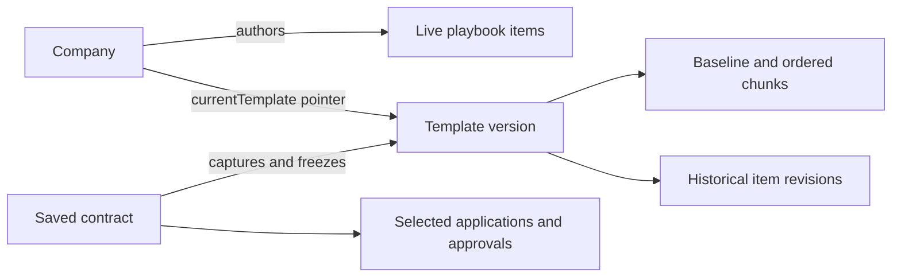

# Current data model

The schema's table map is [src/convex/schema.ts](../src/convex/schema.ts). Read it by domain: accounts, templates, contracts, email, and maintenance. Business content, stored records, and API views have separate responsibilities.

## People and company access

`profiles` describe people and their authentication identity. `memberships` connect people to a company and own their Rep/Admin role. The indexed transactional join enforces at most one membership per profile. Ownership is independent: `company.ownerProfileId` identifies the owner, who may choose the Rep role. Missing ownership supports operator recovery; a missing baseline means setup is incomplete.

`accounts.viewer` returns a profile, optional membership, optional company, and derived permissions. `requireMembership` returns an explicit access object with an actual profile and membership. The server derives identity, checks expected membership IDs, and rejects unavailable or deleting companies. Role is never an account-profile property in the canonical API.

`profiles`, `memberships`, and `companies` own their respective update APIs. `avatars` owns avatar authorization/storage operations. Invitations capture their own lifecycle; their delivery summary is a list projection of an authoritative email delivery.

`company.csmCallBookedAt` records the first confirmed setup booking. Native accepted
creation/recovery commits it atomically with the receipt; verified legacy Cal
webhooks retain their one-way completion policy. The viewer projects it as
`csmCallBooked`, permanently switching admin-only setup to Support across workspace
routes and members. Support bookings never change it. `csmBookingAttempts` stores
durable creation receipts and unresolved acknowledgement recovery, not current
appointment history or occupancy. Confirmation is immutable; Cal owns later
cancellation/rescheduling. Exact signed attempt association attributes native
provider facts; a separately signed company/purpose reference supports legacy
webhooks. `csmSetupAppointments` separately stores one mutable setup-chain snapshot with
immutable source attribution, current provider facts and bounded sync/deadline jobs.
Its optional `pendingSuccessors` object holds at most eight unresolved UIDs and a
sticky overflow flag; the old optional `successorHint` remains read compatible.
Only a complete same-generation scoped chain proof clears pending state. Overflow,
partial proof and quota deferral retain dirty repair for ordinary chains, including after a call ends;
imports/reseeds cannot reset overflow. Legacy duplicates converge only under a proof
covering every affected locator/obligation while preserving the oldest frozen binding.
Only company admins subscribe to its minimal display query; Support never selects
it. Scheduled expiry advances display selection independently of provider repair.
Reversible company deletion preparation/dispatch retains the row, clears freshness
and defers ordinary work; cancellation/TTL expiry resumes it dirty. Permanently
superseded predecessors remain retired through pauses. Already claimed bounded
GETs may continue, with ownership and generation/lease/current-UID checks at commit.
Current-state dates require explicit, valid instants; creation receipts keep their
existing parser. Refresh-local quota waits preserve action-local proof progress within
the lease, without retrying dispatched failures or extending the lease.
Source-profile and company cleanup drain snapshots/jobs without changing receipts
or reversing promotion. Setup replacement attempts optionally freeze predecessor
appointment ID/current UID. The predecessor stores its latest attempt pointer,
permanent successful supersession and an anonymous erased-uncertain marker; shared
progress derives from canonical attempt state rather than a second state machine.
Success atomically seeds an independent child chain and retires the old row with
`selection: 'superseded'`, separate from recoverable ordinary `hidden` chains. One
shared transition clears pending local jobs, lease and repair/freshness deadlines and
invalidates captured proof. No recurring predecessor maintenance resumes after child
cancellation, end or erasure. Historical identity/facts and bounded unresolved hints
remain, including sticky overflow; terminal webhooks acknowledge known association
and retain hints without refreshing or re-adopting the predecessor. Ordinary hidden
chains keep missed-event revisit and proof repair. Replacement-aware legacy rows cannot merge away stable targets.
Before private receipt erasure, constant-work reconciliation preserves success,
releases proven noncreation, or blocks uncertain recreation without retaining PII.
All company admins may inspect sanitized source status/recover the canonical attempt;
private receipts remain membership-owned. See [CSM booking](delegation.md).
Proof cleanup owns its exact incrementing lease token independently of a later safe
retry's reservation pointer; final admission still requires the canonical pointer.
Bounded private snapshot normalization and aggregate completion inventory are separate
operator steps after deploying all additive terminal-aware writers together, before
frontend enablement. A compatible UI rollback must retain the terminal schema and
backend safeguards; neither normalization nor rollout runs automatically.

## Templates and historical content

Each company owns an active baseline and live playbook items. Baseline blocks are ordered, bounded child documents. Playbook business validators live in `src/lib/playbook/validators.ts`; shared content normalization/equality lives in `content.ts`. UI field labels do not define persistence.

Source and resolved tables share one `rows: string[][]` shape. Cells have no source coordinates, references, annotations or concession changes. Composition returns each immutable table unchanged. Pagination prepares one plain display token per cell, and Word export consumes the strings. Selections cannot target cells or cross any table, including an empty table.

A live head stores company/revision/replay identity, stable render identity and packed
structure. `playbookItemRevisions.body` is the sole instruction/replacement-content
authority. Revision wrappers preserve original item identity and current compatibility
metadata; historical projections omit that transport metadata. Original item IDs remain
meaningful after deletion. `baselineAuthoring` and `baselineValidationChunks` contain
private certified coordinate/numbering facts without source prose. See
[admin authoring storage](admin-authoring-storage.md) for read contracts and conversion.

`templateVersions` contain the baseline and ordered item/revision references. `currentTemplate` is one pointer per company. A version is `mutable` while no contract has captured it. Contract creation atomically changes it to `frozen`; later authoring creates another version. Deleting the capturing contract never makes a version mutable again. Mutable-only revisions can be replaced or removed; frozen revisions retain their captured content.

Template saving commits exact JSON/native counters and company-monotonic authoring
and structural generations with head/revision/receipt/manifest/pointer changes. Ordinary
saves serialize only the changed historical body. Structural changes validate affected
relations against certified compact facts and heads; prose edits need only metadata and
the changed body. Initial/bulk acceptance and conversion perform complete audits.
`currentStructure` serves annotations; `detail` hydrates selected instruction content;
the compatibility full list resolves the revision manifest directly. Native admission
and rollback checks remain independent of business JSON limits.

## Contracts, applications, and review

`savedContracts` reference a captured template and use `buyerCompanyName` for the buyer. `companyId` always means the owning workspace company. The canonical API is `contracts`.

Each contract stores one bounded `applications` map keyed by original playbook-item ID. Each value contains a concession ID and, when required, `approval: { applicationId, status }`. The immutable template determines whether approval is required. A save command carries choices and application IDs; it cannot submit approval status. Confirmed state, local intent, and an outstanding immutable request remain separate because they represent different moments.

Playbook `approvalPolicy` is explicitly `none` or `required` with guidance text. The existing text editor maps nonblank approval guidance to `required` and clearing it to `none`. Business readiness reads the policy discriminator, independently of layout or whether the guidance is currently displayed.

`contractApprovals` owns requests, decisions, and completion/reset operations. Decisions compare contract, item, concession, and application identity. Admin applications retain automatic approval and immutable decision receipts. Reset and remove/reapply behavior establish fresh review identities; retries preserve the original identity. `concessionDecisions` is the audit/replay history. `approvalRequests` holds only the latest request per contract; email deliveries retain their own outcomes.

| Name                 | Meaning                                                                                |
| -------------------- | -------------------------------------------------------------------------------------- |
| `contentRevision`    | A playbook item's business-content revision                                            |
| `editRevision`       | Concurrency guard for saved contract choices/application resets                        |
| `stateVersion`       | Freshness of all mutable contract state, including renaming, decisions, and completion |
| `reviewGeneration`   | Invalidates stale completion/reset and decision-email context                          |
| `applicationId`      | One application of one concession, including its current review identity               |
| `operationId`        | One immutable request's retry/replay identity                                          |
| Transport generation | One connection lifetime; stale outcomes cannot update its replacement                  |
| Delivery attempt     | One provider attempt, with its own idempotency and uncertainty rules                   |

`contractDirectory` is one derived browse/search row per contract. Its writer updates it transactionally with relevant contract changes; browsing does not read growing application state. Creator references may outlive profiles and fall back to former-colleague attribution. Creation receipts deliberately survive deletion to prevent retries resurrecting removed records.

## Targets, rendering, and lifecycle owners

A playbook trigger/change has a `target`, which can be text or a structural boundary. A text target contains an actual source `range`. Document annotations and review tags follow that distinction. `TemplateContent` means captured business/source content; `RenderSnapshot` means composed page output.

`AccountLifecycle` owns account readiness and safe exits. `ConvexConnection` owns connection replacement. `ContractEditors` owns per-contract `ContractEditor` lifetimes across routes. `ContractPersistence` owns confirmed state, local intent, recovery, and one outstanding save. Its resolution is current, conflicted, failed, or deleted; transport pause and editing freeze are independent controls. `ContractReviewController` owns request/decision retries and subscription reconciliation; the view owns focus and presentation.

`savePending()` initiates contract saving and waits. Authoring `waitForSubmittedOperation()` waits without submitting an unsaved draft. The account boundary calls each editor's `prepareToLeave()` contract and checks whether work is clean. `useConfirmedState()` adopts subscribed state after resolving an outstanding operation; it does not issue a fresh read.

Readiness signals describe different facts: `hostReady`, current primary presentation (`pending | success | error`) and its paint ticket, account `workspaceAdmitted`, contract-editor `accessAvailable`, and viewer `layoutPrepared`, `pagesVisible`, and `interactionEnabled`.

The shell owns the membership-scoped optimistic setup-booked fact. Current
route/query, baseline phase, local primary replacement/retry and connection
identity govern first/new optional CSM initialization after content paints.
Already initialized support persists across routes. Its deferred feature owns a
single frozen modal request; the request-only body owns a bounded attribution
subscription and native calendar. Provider requests begin only inside the opened
modal. Closing disposes visible reads; accepted backend work continues. A live
receipt query owns booking state, and confirmed creation/recovery writes permanent
setup completion. See [CSM calls](delegation.md).

## Integration catalog

`src/lib/integrations.ts` owns the shared informational integration catalog in application code. Home and detail pages read it synchronously, with an admin presentation gate. Array membership and order control display; content kind controls detail availability. Copy and logos ship with the website, independently of Convex and optional company contract/playbook seeding. See [integration catalog](integrations.md) for content maintenance and the transition from the former stored catalog.

## Email, caches, and maintenance

`emailDeliveries` owns dispatch, provider outcome, retry, cancellation, and disposal. Named event validators distinguish approval, decision, and invitation events. `emailSelectionChunks` contains ordered, bounded captured selections; optional approval metadata is one atomic object. Invitation summaries have a centralized writer and delivery/generation guards. An uncertain outcome never proves non-delivery or authorizes automatic replay.

Browser confirmed caches receive an immutable scope containing deployment/profile/membership identity. Cache replacement disposes old work, closes its recent-opening store, clears disposable data, and publishes the new resource. Constructors receive scope directly. Shared template flights, metadata-only writes, entry/byte bounds, deadlines, and storage fallback remain in place.

The separate tab-scoped draft journal contains user intent in the `dinu:drafts:v4` namespace and accepts only version-4 payloads. Operation, application and expected-revision identities round-trip unchanged. There is no legacy decoding or namespace fallback. Explicit contract, user and membership discard clears current checkpoints. Confirmed-cache upgrades are disposable and never clear current journals; their format is documented in [template storage](template-storage.md#browser-persistence). Cache contents never replace fresh authorization and saved-state confirmation when opening a contract. Deletion is terminal for persistence: outstanding transport outcomes cannot recreate a cleared checkpoint.

Account deletion, company cleanup, and file sweeps retain bounded work and their own retention rules. Parent deletion does not imply that every historical reference must immediately disappear.

The canonical seed retires the monthly-fee discount rule and five concessions. It has 112 blocks, three static tables, 55 items, 21 concessions and 29 changes. Table strings match the already-reset development and production databases. No table compatibility conversion is needed. These local cleanup changes do not deploy or reset a database.

## Compatibility and release

Temporary v1 adapters keep old account, contract, authoring, template, approval, and export calls usable across a non-atomic release. Canonical code uses `accounts`, `contracts`, `contractApprovals`, `playbookItems.current`, and `templates.content`. The v1 block projection in `legacyViews` omits title roles from flow blocks and shares canonical static table strings, including template, baseline and Node export reads. Compatibility views are isolated in the `legacy*` modules and old API entry points; they do not define stored records. Retire them after the supported old clients/actions have been accounted for.

See [production releases](deployment.md) for release mechanics. Ordinary pushes to `main` do not convert stored data.
