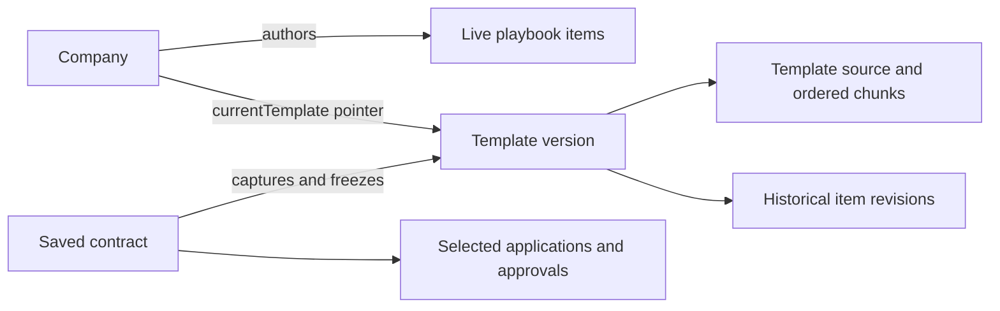
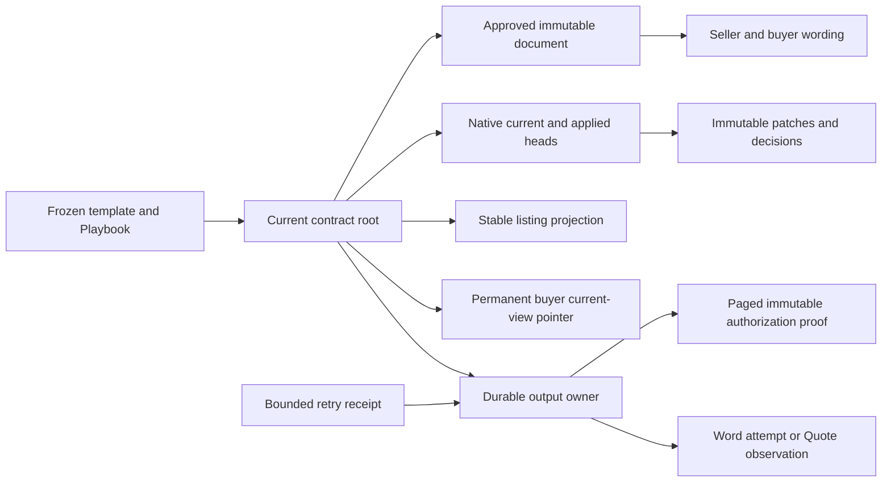

# Current data model

Reusable company setup is a **template**; a buyer-specific instance is a **contract**. Shared text/rendering machinery is a **document**. The authoritative table map is [schema.ts](../src/convex/schema.ts).

| Owner                 | Authority                                                                                           | Lifetime                                    |
| --------------------- | --------------------------------------------------------------------------------------------------- | ------------------------------------------- |
| Accounts              | Profiles, memberships and company ownership                                                         | Person or company                           |
| Template authoring    | Compact heads, immutable revision bodies, current manifest and certified source                     | Company                                     |
| Frozen templates      | Permanently frozen template manifests and referenced Playbook/source content                        | Company, including after contract deletion  |
| Contracts             | One small `savedContracts` root and its approved document                                           | Contract                                    |
| Native changes        | Immutable patches, exact current/applied heads and immutable decisions                              | Contract; output evidence has its own owner |
| Browse and buyer view | Derived `contractDirectory` and permanent `buyerLinks.currentView`                                  | Contract                                    |
| Discussions           | Shared contract threads/messages, interval claims, transient maps and exact unread/support indexes  | Contract                                    |
| Operations            | Original-input/result `operationReceipts` and separately paged evidence sections                    | Seven-day replay; 24-hour collection grace  |
| Outputs               | `contractOutputs` and proof chunks, Word attempts and Quote observations with full/compact variants | Evidence/holds, then company-lifetime facts |
| Integrations          | Captured destinations, leases, dispatch and reconciliation                                          | Each protocol's retention                   |
| Maintenance           | Bounded deletion, preparation and cleanup progress                                                  | Until owned work completes                  |

The seller dashboard and both anonymous and authenticated buyer-link views display one current approved document. Pending alternatives appear only in focused reviews. The strict schema/client release requires classified target inventory, preservation conversion where populated and matching client retirement/reload. A concrete offline current-schema bundle preserves original history; older/unknown schemas require their own bounded plan. All G01–G25 remain UNVERIFIED; local preparation performs no target operation. See [release procedure](deployment.md#backend-ownership-conversion).

## People and company access

`profiles` describe people and their authentication identity. `memberships` connect people to a company and own their Rep/Admin role. The indexed transactional join enforces at most one membership per profile. Ownership is independent: `company.ownerProfileId` identifies the owner, who may choose the Rep role. Missing ownership supports operator recovery; a missing template source means setup is incomplete.

`buyerLinkBarShowings` remembers one presentation per membership and unlinked contract; `memberships.firstBuyerLinkHintShowing` remembers the dashboard's first-link hint. Contract deletion drains showing records through its bounded cleanup, and account/member removal queues a durable bounded drain before deleting the membership. Company deletion drains both showing records and pending membership drains before removing the company.

`accounts.viewer` returns a profile, optional membership, optional company, and derived permissions. `requireMembership` returns an explicit access object with an actual profile and membership. The server derives identity, checks expected membership IDs, and rejects unavailable or deleting companies. Role is never an account-profile property in the canonical API.

`profiles.helpPreferences` contains required `rep` and `buyer` booleans, where
`true` suppresses automatic Help. Both default to `false`. Only the authenticated
profile owner can change either flag through `profiles.setHelpHidden`; the mutation
preserves the other flag. The private account and seller-context queries return the
preferences at the top level; shared profile/colleague views do not expose them.
Seller buyer preview has no checkbox and cannot initiate preference writes.
Anonymous buyers keep per-link browser preferences. This required shape has no runtime fallback. A target missing it needs a bounded preservation/disposition plan before the matching frontend/backend release; an old reset record proves no current population facts.

`profiles`, `memberships`, and `companies` own their respective update APIs. `avatars` owns avatar authorization/storage operations. Invitations capture their own lifecycle; their delivery summary is a list projection of an authoritative email delivery.

Home’s setup prompts guide both reps and admins to create a contract and then create a buyer link for their latest own contract. The “Create link” button uses the shared `BuyerLinkController` to create and copy the link directly from Home. `accounts.setupHints` checks the member’s latest own contract and reads `buyerLinks` through its company/creator index. Any link created by the member in the current company, or an existing link for their latest contract, satisfies this step. Link creation through any entry point advances setup even if copying fails; previewing alone does not. Clipboard successes and failures use the shared workspace feedback. Setup no longer needs a client copy-progress marker or acknowledgment mutation; `memberships.buyerLinkCopiedAt` is absent from the strict schema; its target field removal requires G07 clearance. Admins continue to integrations and inviting colleagues; integration read errors do not advance to invitations.

`company.pendingTemplateSourceId` identifies at most one company-owned pending
DOCX. Successful valid import adopts it atomically with `uploadedAt` and a 90-day
`expiresAt`; replacing it retires the previous pending source through bounded
cleanup. Uploader attribution does not make it personal data owned by that member.
Cancellation, rebooking and uploader departure retain it. Only internal
`operator.releasePendingTemplate`, scoped to company, exact source and expected
fingerprint, can release an ordinary upload into `company.templateSourceId` and
the first canonical version. Until then, the editor and instructions stay gated.
The admin-only `templateUploads.status` returns booking/upload/waiting/released
and bounded pending metadata; reps receive no pending metadata. See the
[operator runbook](assisted-template-setup.md).

`company.setupAppointmentId` identifies the company's current native setup call.
Its owned appointment's last decisive `bookingConfirmation` (`accepted` or
`cancelled`) controls pre-release upload and operator-release qualification. An
accepted creation qualifies while provider refresh is checking and after the call
ends; pending proof or refresh failure preserves the last decisive fact. A known
cancellation requires an exact replacement appointment ID/current UID before new
setup work. A dangling or uncertain target never becomes a fresh initial booking.
The viewer projects `setupBookingConfirmed`; support bookings never qualify setup.
The header may hide ended calls without changing this durable qualification.

`csmBookingAttempts` stores durable creation receipts and unresolved acknowledgement
recovery, not current appointment history or occupancy. With no current setup
appointment, unresolved initial attempts serialize new setup bookings across
company admins; another admin sees neutral progress, never a private receipt.
Exact receipt replay/recovery remains available before new-work admission. Native
accepted settlement binds the company pointer; historical receipt replay cannot
move it backwards. Exact signed attempt association attributes native provider
facts; a separately signed company/purpose reference supports legacy webhooks.
Canonical attempt format 2 requires creation confirmation for booked rows and a
noncreation basis for failures. Legacy/unverifiable outcomes fence fresh work
without inventing confirmation; this assisted setup flow adds no migration or
legacy qualification.
`csmSetupAppointments` separately stores one mutable setup-chain snapshot with
immutable source attribution, current provider facts and bounded sync/deadline jobs.
Its optional `pendingSuccessors` object holds at most eight unresolved UIDs and a
sticky overflow flag; the old optional `successorHint` remains read compatible.
Only a complete same-generation scoped chain proof clears pending state. Overflow,
partial proof and quota deferral retain dirty repair for ordinary chains, including after a call ends;
imports/reseeds cannot reset overflow. Legacy duplicates converge only under a proof
covering every affected locator/obligation while preserving the oldest frozen binding.
Only company admins subscribe to its minimal display query; Support never selects
it. Scheduled expiry advances display selection independently of provider repair.
Reversible company deletion preparation/dispatch retains the row, clears freshness
and defers ordinary work; cancellation/TTL expiry resumes it dirty. Permanently
superseded predecessors remain retired through pauses. Already claimed bounded
GETs may continue, with ownership and generation/lease/current-UID checks at commit.
Current-state dates require explicit, valid instants; creation receipts keep their
existing parser. Refresh-local quota waits preserve action-local proof progress within
the lease, without retrying dispatched failures or extending the lease.
Source-profile and company cleanup drain snapshots/jobs without changing receipts
or reversing promotion. Setup replacement attempts optionally freeze predecessor
appointment ID/current UID. The predecessor stores its latest attempt pointer,
permanent successful supersession and an anonymous erased-uncertain marker; shared
progress derives from canonical attempt state rather than a second state machine.
Success atomically seeds an independent child chain and retires the old row with
`selection: 'superseded'`, separate from recoverable ordinary `hidden` chains. One
shared transition clears pending local jobs, lease and repair/freshness deadlines and
invalidates captured proof. No recurring predecessor maintenance resumes after child
cancellation, end or erasure. Historical identity/facts and bounded unresolved hints
remain, including sticky overflow; terminal webhooks acknowledge known association
and retain hints without refreshing or re-adopting the predecessor. Ordinary hidden
chains keep missed-event revisit and proof repair. Replacement-aware legacy rows cannot merge away stable targets.
Before private receipt erasure, constant-work reconciliation preserves success,
releases proven noncreation, or blocks uncertain recreation without retaining PII.
All company admins may inspect sanitized source status/recover the canonical attempt;
private receipts remain membership-owned. See [CSM booking](delegation.md).
Proof cleanup owns its exact incrementing lease token independently of a later safe
retry's reservation pointer; final admission still requires the canonical pointer.
Bounded private snapshot normalization and aggregate completion inventory are separate
operator steps after deploying all additive terminal-aware writers together, before
frontend enablement. A compatible UI rollback must retain the terminal schema and
backend safeguards; neither normalization nor rollout runs automatically.

## Templates and historical content

Each company owns an active template source and live playbook items. Source blocks are ordered, bounded child documents. Template item business validators live in `src/lib/playbook/validators.ts`; shared content normalization/equality lives in `content.ts`. UI field labels do not define persistence. `TemplateItem` is a union discriminated by required `audience`: `RepInstruction` has `audience: 'rep'`, ordinary instructions, canonical `approvalPolicy` and concessions; `BuyerExplanation` has `audience: 'buyer'`, a text trigger and explanation. Drafts, save payloads, immutable revision bodies, snapshots and decoded structures retain that explicit audience. Rep approval guidance edits policy directly, preserving exact nonblank text; clearing or whitespace-only text means `kind: 'none'`. The four ordinary instruction fields preserve empty versus absent strings. Populated releases must convert original captured bodies and recount/recertify representation sizes without changing business IDs, content revisions or captured template versions.

Source and resolved tables share one `rows: string[][]` shape. Cells have no source coordinates, references, annotations or concession changes. Composition returns each immutable table unchanged. Pagination prepares one plain display token per cell, and Word export consumes the strings. Selections cannot target cells or cross any table, including an empty table.

A live head stores company/revision/replay identity, stable render identity and packed
structure. `playbookItemRevisions.body` is the sole instruction/explanation/replacement-content
authority. Revision wrappers preserve original item identity and current compatibility
metadata; historical projections omit that transport metadata. Original item IDs remain
meaningful after deletion. `templateSourceCertificates` and `templateSourceValidationChunks` contain
private certified coordinate/numbering facts without source prose. See
[template authoring storage](template-authoring-storage.md) for read contracts and conversion.

`templateVersions` contain the template source and ordered item/revision references. `currentTemplate` is one pointer per company. A version is `mutable` while no contract has captured it. Contract creation atomically changes it to `frozen`; later authoring creates another version. Deleting the capturing contract never makes a version mutable again. Mutable-only revisions can be replaced or removed; frozen revisions retain their captured content.

Template saving commits exact JSON/native counters and company-monotonic authoring
and structural generations with head/revision/receipt/manifest/pointer changes. Ordinary
saves serialize only the changed historical body. Structural changes validate affected
relations against certified compact facts and heads; prose edits need only metadata and
the changed body. Initial/bulk acceptance and conversion perform complete audits.
`currentStructure` serves annotations; `content` hydrates selected item content. Native admission
and rollback checks remain independent of business JSON limits.

## Contracts, documents, and review

`savedContracts` is the sole small business root: company/creator, frozen template, title/buyer, `documentId`, `documentRevision`, `stateRevision`, `savedAt`, last-operation acknowledgment, bounded Playbook counts, two fixed review contexts and optional constant-size `quoteRequests` ordering/latest metadata. Creation inserts a root with a temporarily null document pointer, materializes its owned document and patches the root in the same transaction. Every committed readable root has a document. There is no partial-root recovery lifecycle or growing selection/application array.

`documentRevision` advances only when approved wording changes. `stateRevision` fences business state relevant to commands and output admission. A meaningful save/decision writes final root metadata once; creation uses two atomic root writes. No-op/replay preserves existing zero-write behavior except required acknowledgment receipts. `contractState.Contract` joins this root and its optional HubSpot association; document reads do not require a second mutable working-state record.

`contractDocuments` and `contractDocumentChunks` hold immutable wording, piece origins and numbering aliases with unchanged chunk reuse. Frozen `templateVersions` and `playbookItemRevisions` remain necessary source owners. Cumulative redlines compare with the frozen original. Pending work and metadata-only changes do not rewrite approved wording.

`contractChanges` has native `playbook` and `buyer-link` variants. `contractChangeContents` stores exact before/after/reversal/dependency payload once. Each change freezes policy, initiating actor, original operation, predecessor and source. Playbook source identifies a frozen item/option and apply/removal action. Buyer source freezes the exact root message/revision, replacement text and original anchor/quote/document identity. A thread reference is never an existence prerequisite for undo of an applied change.

`contractChangeHeads` has one indexed head per contract, native kind and semantic key. It stores required nullable `current` and `applied` bundles, with change identity and exact review evidence together. Playbook bundles also own option/policy; policy `none` cannot carry a decision, required current policy owns a pending admission revision or an exact decision, and required applied policy owns its exact approved decision. Buyer-link bundles cannot carry Playbook fields. Only Playbook heads have the indexed `activePlaybook` projection, atomically derived from non-base current/applied options. Empty heads are deleted. Ordinary and staged writers share constructors, consistency checks, restoration and compact projections. `contractChangeDecisions` stores immutable admin evidence; status derives from policy and the effective decision. A replayed no-op does not add a semantic decision. Restricted option removal/replacement remains pending over its applied predecessor. Withdrawing pending work restores that predecessor. Undo uses exact immutable inverse/dependency checks and retains its reason when conflicts disable it.

A floating buyer support (`current != applied`) is effective only while its exact source root revision and passage survive committed discussion maps. Invalid support immediately exposes its applied predecessor/decision or absence. Applied equality is source-independent. Logical cancellation updates readiness, request coverage, context freshness and unread in the approved-document transaction; it does not require a physical write for every affected buyer head. Maintenance later normalizes those exact stale heads before retiring their cancellation maps. Raw unsupported buyer proposals never block first share or seller output.

The two approval contexts are `playbook` and `buyer-link`. The root stores exactly `reviews.playbook` and `reviews.buyerLink`, each with one constant-size `identity` and an optional `completion` bound to its captured review identity. A token changes only when that context's effective change/decision tuples change; unrelated title/document edits and physical maintenance leave it fixed. Readiness reads exact bounded Playbook counts and the discussion control's exact buyer support counts. Review/blocker details page through native heads, preserving native continuation/split metadata and empty nonterminal pages.

`contracts.saveChanges` retains per-item expectations, ordered immutable operation inputs and disjoint-command merging. `contractApprovals.decideChange` applies native decisions; `discussionProposals.support/withdraw` handles buyer support without fake Playbook options or a duplicate buyer decision API. `contractApprovals.request/confirmCompletion` handles explicit submission and the existing completion-notification choice. Exceptional work returns an owned preparing result; the original journal/controller retains the same operation until completion.

`approvalRequests` retains only the latest request for each contract/context. Its immutable delivery snapshot identifies exact native changes and the root state-revision cutoff. Current coverage intersects each original entry with its exact effective pending head; canceling A cannot erase B's submitted status. Pending activation revisions renew on reactivation. The support control maintains exact covered/unsubmitted counts under the cutoff. Large snapshots stage through existing delivery/selection chunks on the original receipt, and activate only after a complete seal. Completion checks the current context token and counts. Email filtering pages the snapshot, then fences its filtered manifest before granting the existing send lease; sent/failed/uncertain evidence and explicit notification choice remain.

`contractDirectory` is a maintained derived listing/search/provider projection, with title, creator, saved/created ordering, association summary and exact `hasUnreadComment`. One centralized writer patches only actual projected-field changes. Root/head/receipt/index/preparation churn alone does not invalidate Home, search or Past links. Creator presentation is memoized per read. Provider delivery retains its real-root/association fallback when a directory projection is absent, plus original destination, generation, credential, block and reconciliation fences.

The permanent buyer link has a small `currentView` pointer to approved document/revision, displayed title, frozen template/source and buyer name. It updates atomically only for buyer-visible changes and is synchronously revoked on logical contract deletion. `buyerLinks.currentDocument({token})` serves the same document to both audiences through that pointer and immutable data. Public acquisition is independent of seller account readiness and private root/head subscriptions. Every read still checks the live link/company/deletion gate; pointers, directory rows and retained documents never authorize independently. Buyer download binds the displayed identity before and after generation and returns those exact bytes or a conflict.

Optional `contractHubspotAssociations` owns the CRM destination; `contractBuyerRefreshes` separately owns destination-bound buyer-name freshness. Buyer names stay outside saved intent and confirmed caches. Association/provider generations are independent safety fences and remain.

## Targets, rendering, and lifecycle owners

A playbook trigger/change has a `target`, which can be text or a structural boundary. A text target contains an actual source `range`. Document annotations and review tags follow that distinction. `TemplateContent` means captured business/source content; `RenderSnapshot` means composed page output.

`AccountLifecycle` owns account readiness and safe exits. `ConvexConnection` owns connection replacement. `ContractEditors` owns per-contract `ContractEditor` lifetimes across routes. `ContractPersistence` owns confirmed state, local intent, recovery, and one outstanding save. Its resolution is current, conflicted, failed, or deleted; transport pause and editing freeze are independent controls. `ContractReviewController` owns request/decision retries and subscription reconciliation; the view owns focus and presentation.

`savePending()` initiates contract saving and waits. Authoring `waitForSubmittedOperation()` waits without submitting an unsaved draft. The account boundary calls each editor's `prepareToLeave()` contract and checks whether work is clean. `useConfirmedState()` adopts subscribed state after resolving an outstanding operation; it does not issue a fresh read.

Readiness signals describe different facts: `hostReady`, current primary presentation (`pending | success | error`) and its paint ticket, account `workspaceAdmitted`, contract-editor `accessAvailable`, and viewer `layoutPrepared`, `pagesVisible`, and `interactionEnabled`.

The shell owns the membership-scoped optimistic setup-booked fact. Current
route/query, template source phase, local primary replacement/retry and connection
identity govern first/new optional CSM initialization after content paints.
Already initialized support persists across routes. Its deferred feature owns a
single frozen modal request; the request-only body owns a bounded attribution
subscription and native calendar. Provider requests begin only inside the opened
modal. Closing disposes visible reads; accepted backend work continues. A live
receipt query owns booking state, and confirmed creation/recovery writes permanent
setup completion. See [CSM calls](delegation.md).

## Integration catalog

`src/lib/integrations.ts` owns the shared informational integration catalog in application code. `/integrations` and detail pages read it synchronously, with an admin presentation gate. Array membership and order control display; content kind controls detail availability. Copy and logos ship with the website, independently of Convex and optional company template/instructions seeding. See [integration catalog](integrations.md) for content maintenance and the transition from the former stored catalog.

## Email, caches, and maintenance

`operationReceipts` owns original operation identity, immutable input/result bytes and required `preparing | complete | failed` state. Its ordinary payload remains within the existing inline/63-chunk envelope. Normal replay decodes only the `payload` section. Receipt keys derive from authenticated company/actor ownership, rather than caller operation IDs alone. Contract operation, creation and ordinary discussion retries expire seven days after their original `op1` identity time; physical receipt collection starts only after another 24 hours and all dependency gates. Removing a receipt cannot admit its expired identity again. Independent protocols keep their own identity and retention rules.

`contractOutputs` owns output preparation, the captured manifest and its canonical hash, proof generation/verification/garbage, immutable lifecycle deadlines and provider observation identity. `contractOutputChunks` owns the separately paged `output-proof` fragments. Seals bind output/company/contract, original operation/actor/source/destination, section and generation; four-chunk folds verify order, counts, bytes and fingerprints. Proof never enters ordinary replay serialization. Word replay stores `{attemptId, outputId}`; Quote reservation replay stores `{outputId}`. A receipt backlink exists only during private preparation and clears atomically on activation or retirement. Completed output readers and callbacks use `outputId` independently of replay receipts.

`contractExports` owns Word reservation, file-byte publication, release and acknowledgment; the public `wordExport.generate` Node action calls `wordExportGeneration.generateWordExport` to generate bytes. Physical `hubspotExports` IDs remain stable for download journals and later compact history. Full attempts/pushes use their durable output manifest and paged proof. Final activation/release adopts a sealed proof and compares fresh source/destination fences without rescanning or rewriting the full proof. Canonical output identity is separate from context freshness and can match after an exact reversal. Root `quoteRequests` allocates monotonic reservation times and records the newest committed request, including reuse of an older canonical push. Latest reads follow that pointer and full/compact push facts; reuse never transfers the push's original output owner or changes document/state/directory revisions.

Outputs, Word attempts and Quote pushes discriminate `format: 'full' | 'compact'`. Full output evidence lasts at least 90 days from immutable settlement: Word's first release, or the later of a Quote request's original commit and its provider's conclusive settlement. All independent file, attachment, acknowledgement, delivery, lease and reconciliation holds must also end. Compact facts retain identity/fingerprints, title, actor profile/membership IDs, times, file metadata and factual destination/remote outcome for company lifetime. They drop exact request/proof/manifest bytes, actor email snapshots, tokens and direct source-document ownership. Compact history cannot regenerate/release bytes or reconstruct all original wording and approval details. Unresolved external outcomes keep their full evidence without a fixed TTL; successful canonical fences survive compaction.

Ordinary immutable document history remains for a live contract's lifetime. Only full output owners impose the coarse deleted-contract document hold. Cleanup verifies full proof/document seals before source removal, then parks `contractCleanups` in `waitingDocuments` while any full owner remains. Final owner release wakes it atomically; indexed hourly recovery repairs lost wakeups. New output/document acquisition checks the same live root/cleanup marker transactionally. Once all full owners end, cleanup drains every remaining manifest, then the entire contract chunk range, before removing the marker. A shared chunk is never reclaimed merely because one output expired. An unresolved output may retain all remaining deleted-contract history indefinitely; compact facts impose no hold. See [retention](retention.md) for native promotion, collection budgets, distinct clocks and reconstruction limits.

`hubspotExportDeliveries` separately owns the captured destination, remote-file
identity and attachment entitlement. A late acknowledgement uses the original
actor/destination even after file expiry or contract deletion. It cannot attach
unavailable bytes. Uninstall retires provider entitlement; company erasure drains
both core and provider owners. Provider-specific admission, delivery and booking
state machines remain separate.

`emailDeliveries` owns dispatch, provider outcome, retry, cancellation, and disposal. Named event validators distinguish approval, decision, and invitation events. `emailSelectionChunks` contains ordered, bounded immutable native review entries and their snapshot hashes. Complete snapshots detach their staging receipt backlink and retain their independent execution/outcome owner; private snapshots must retire or finish disposal before receipt collection. Invitation summaries have a centralized writer and delivery/generation guards. An uncertain outcome never proves non-delivery or authorizes automatic replay.

Browser confirmed caches receive an immutable scope containing deployment/profile/membership identity. Cache replacement disposes old work, closes its recent-opening store, clears disposable data, and publishes the new resource. Constructors receive scope directly. Shared template flights, metadata-only writes, entry/byte bounds, deadlines, and storage fallback remain in place.

The separate tab-scoped draft journal owns pending user intent. Its namespace, accepted payload formats, bounded commands, immutable retry identities and discard rules are documented in [template storage](template-storage.md#browser-persistence), along with the independent disposable confirmed cache. Confirmed-cache upgrades never clear current journals. Cache contents never replace fresh authorization and saved-state confirmation when opening a contract. Deletion is terminal for persistence: outstanding transport outcomes cannot recreate a cleared checkpoint.

Hourly `retentionMaintenance` uses one global `retentionSweeps` progress row, an immutable captured cutoff and indexed operation/creation/discussion/output phases. Each turn visits at most one candidate and advances past held/failed work; versioned continuation recovery preserves the exact cutoff/cursor. Owner work retains transaction reserves and bounded fragment batches. The hourly discovery interval never resets evidence, retry, byte or acknowledgement clocks.

Account deletion selectively retires private actor-owned preparation while preserving company evidence and canonical fences. Company deletion shares one transaction budget across core and provider drains, including output owners/chunks; final phases recheck children so already-running cleanup markers cannot skip them. Company erasure remains the local history boundary without inventing an external provider outcome.

The canonical seed retires the monthly-fee discount rule and five concessions. It has 112 blocks, three static tables, 55 items, 21 concessions and 29 changes. These are local canonical seed facts; historical deployment snapshots do not establish the current target. The seed transport/operator/audit use canonical source/item tables and never substitute for preservation conversion.

## Browser storage and release

Disposable confirmed data uses namespace `dinu:v8` and IndexedDB format 16; current contract intent uses `dinu:drafts:v6` and envelope version 12; download acknowledgment uses `dinu:download-acks:v2`. They remain isolated by deployment/account/membership. Current-schema journals keep independent base, intent and exact in-flight request bytes, original operation IDs, malformed-record errors and storage fallback. An apparent current choice match is not acknowledgment. Old envelope 10/11 or malformed bytes under the current journal namespace stay blocked and available for recovery export; other old executable protocols must be fenced with originals preserved. They are never translated/replayed or assigned fresh deadlines. Expired current requests remain blocked until saved-state review and an explicit new deliberate intent.

This strict release requires the [preservation cutover](backend-preservation-cutover.md), exact G01–G25 clearance and matching client reload. Source-only reversion cannot restore converted data/files/components/jobs or external outcomes. Historical work artifacts describe retired designs, not current APIs. Immutable template versions, cache format versions, renderer/event publication and generated-file readiness publication have separate purposes and remain.

## Buyer links and shared discussions

Each contract retains one permanent 13-character, case-sensitive ASCII base62 buyer code with about 77.4 bits of entropy. First creation checks exact current readiness and allocates no publication/capture. Existing-link lookup/copy stays small and independent of editor/source/proof hydration. Buyer URLs carry only the permanent link identity at `/<code>`. Private seller review controls have their own authorized lifetime; public DTOs expose approved wording, buyer explanations and safe geometry, without private policy/decisions.

Discussions exist only on the shared buyer link, including authenticated seller review there. `discussionThreads`, `discussionMessages` and ordinary discussion receipts are contract-scoped. Server ingress derives anonymous authorship from its HttpOnly browser cookie; public author keys grant no authority. Only the real author may edit/delete using the exact message revision. Replies do not withdraw support. Editing/deleting a supported root withdraws only that exact pending support/request entry; new wording requires fresh support/submission. Applied source evidence stays private and independent after the source is removed.

A thread stores one nonempty interval on the approved document's UTF-16/structural tape, indexed document revision, exact unread-message count and permanent tombstone. Unresolved proposal roots have one indexed `discussionPassageClaims` interval; comments can overlap. The shared bounded predecessor probe runs on creation, declined-root reopening and re-support, including admin paths. It refuses closed on unfinished stale probing, retains the original operation and resumes after already-durable maintenance. There is no global proposal/thread/reply cap.

Every approved transition with live discussions commits monotone `discussionInvalidations` maps derived from actual document patches, including references and structural dependencies. At most eight undrained events bound the revision chain. Small maps are inline; larger maps use indexed 4-KiB `discussionTransitionMapChunks`, without a total-map cap. A thread survives only if its complete interval fits an unchanged span of every later map. Historical seams are never merged, so insertion/undo or restored text cannot resurrect an invalidated thread.

`discussionUnreadNodes` and the small `discussionUnreadControls` maintain focused revision-cohort B+ trees. The unread lane contains one entry per positive-unread thread; prefix maximum-start summaries find an exact surviving witness. A separate support lane includes floating supports even at zero unread, handles overlapping declined intervals, and folds exact pending/declined/fallback/covered counts. `reviewCount = appliedBase + effectiveSupport - effectiveSupportWithAppliedFallback`. Nodes have bounded fanout/encoded size and there are at most nine cohorts; these are storage/work bounds, never proposal limits. The approved document, logical thread removal, support cancellation and `contractDirectory.hasUnreadComment` change atomically. Listing reads do not traverse these trees or resolve a pending badge.

Messages retain exact `unreadByTeam` flags. Buyer writes/edits update message revision and thread count atomically; deletion clears the applicable unread contribution. A teammate viewing readable text for 500ms in a focused, unobscured view acknowledges that exact revision using the authenticated client, including View as buyer. An older acknowledgment cannot clear unseen newer text. Public discussion DTOs expose no private read state.

The single per-contract maintenance chain drains the oldest revision prefix in bounded batches. Before tombstoning an affected thread and removing its support/claim/unread entries, it restores or deletes only its still-exact floating head. Survivors rebase thread/support/claim/unread coordinates together. An event retires only after that prefix is empty, preserving cancellation evidence; child messages/receipts drain independently so one large reply thread cannot occupy an event slot. A one-minute `discussionMaintenance.resumeDue` cron repairs absent/failed scheduled jobs. Tombstones and normalized heads prevent resurrection after maps retire.

Small commands keep one-mutation fast paths. Exceptional native construction, geometry, unread/support folds or a full event backlog prepare on the existing original receipt. Durable phases/cursors and actor/source/native/storage/support/unread/request-generation fences own staged documents/patches/maps. Staged rows are invisible until their sealed references are adopted with bounded head/root/event/control/receipt writes in one business commit. The old approved text and exact badge remain visible until then; pending is never success. Authenticated result attachment uses `contracts.operationResult`; anonymous attachment uses the protected same-origin ingress with original input bytes, cookie/account context and `no-store` responses. Live company/deletion and original actor ownership are rechecked before revealing results.

Buyer changes invalidate the complete affected template annotation footprint. Pending/declined proposals do not hide annotations; valid exact reversal can restore them. Applied review tags remain source-independent with gutter fallback and disabled undo reasons. All discussion/index/map/claim/staging rows participate in bounded contract/company cleanup; output proof remains under its independent output owner.

## Buyer-link activity

Activity is recorded automatically for visible buyer openings and clause actions.
Clause events and summaries live in Convex; cookies contain only contract-scoped
browser recognition identifiers and fixed expiries. There are no consent controls.
See [cookies and activity](cookies-and-activity.md) for current policy and limits.

`buyerActivityOpenings` records explicit page openings, distinct clause counts,
server recording times and a fixed 30-day expiry. `buyerActivityReceipts` rejects
changed payloads under reused event IDs and witnesses distinct clause membership
through its opening/item index. New events on an already witnessed clause retain
their own replay receipts without increasing the distinct count. All updates commit
atomically. The strict model has no historical `buyerActivityClauses` or optional receipt `acceptedAt`; G05/G06 require genuine witness deadlines and verified absence before deployment. Required opening `acceptedAt` remains. `buyerActivityCounters` supplies
contract-local visitor numbers without reusing numbers after history expires.
Activity groups openings into visits using the same contract/browser or verified same-company profile, with a 30-minute inactivity boundary. Idle time and clause actions cannot manufacture a return. Openings preserve required server `acceptedAt`, optional verified profile and normalized first-opening city; public bodies cannot supply either identity or city. Public intake retains secret/origin/body validation
and browser/link/company limits; discussions have separate actor/company budgets.

Seller `recent` is an authorized trusted-clock mutation returning the newest ten
unexpired visits expanded into opening/clause rows. Clients refresh while open
and prune expired rows. Indexed bounded daily cleanup physically expires activity;
contract/company deletion removes summaries, children, counters and limiter owners.
Account deletion selectively drains current profile-linked openings and receipt children. Current quotas remain `activityBrowser`, `activityLink`, `activityCompany`, `discussionActor` and `discussionCompany`; anonymous discussion cookie adoption remains independent.

The four raw activity tables, historical clause membership, old quota names, old raw cleanup fields/phases and `buyerVisits.project` are absent locally. Their factual G01–G13 clearance and advanced-marker current-activity catch-up occur under the preserved old bundle before strict release. See [legacy retirement](link-activity-removal.md) before release operations.
