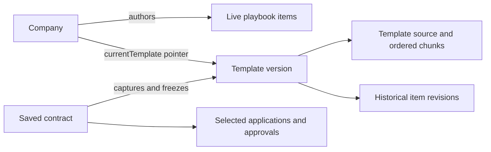
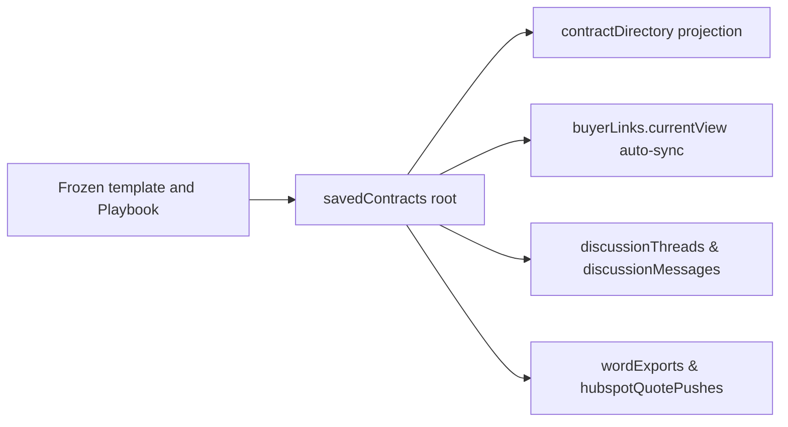

# Current data model

Reusable company setup is a **template**; a buyer-specific instance is a **contract**. Shared text/rendering machinery is a **document**. The authoritative table map (51 tables) is [schema.ts](../src/convex/schema.ts).

| Owner                 | Authority                                                                                  | Lifetime                                   |
| --------------------- | ------------------------------------------------------------------------------------------ | ------------------------------------------ |
| Accounts              | Profiles, memberships and company ownership                                                | Person or company                          |
| Template authoring    | Compact heads, immutable revision bodies, current manifest and certified source            | Company                                    |
| Frozen templates      | Permanently frozen template manifests and referenced Playbook/source content               | Company, including after contract deletion |
| Contracts             | `savedContracts` root with flat `concessions[]`, `review` state, and `quoteRequests`       | Contract                                   |
| Browse and buyer view | Derived `contractDirectory` and auto-synced `buyerLinks.currentView`                       | Contract                                   |
| Discussions           | Shared contract `discussionThreads` and `discussionMessages` with anchor footprints        | Contract                                   |
| Operations            | Flat `operationReceipts` for idempotent retry                                              | 24-hour TTL (daily cron); preserved across single-contract delete |
| Exports and quotes    | `wordExports` (short-lived DOCX bytes) and `hubspotQuotePushes` (30-day HTML + facts)      | Byte TTL / company lifetime                |
| Integrations          | Captured destinations, leases, dispatch and reconciliation                                 | Each protocol's retention                  |
| Maintenance           | Bounded deletion, preparation and cleanup progress                                         | Until owned work completes                 |

The seller dashboard and buyer-link views both compose the contract directly from its frozen `templateVersions` snapshot and applied Playbook concessions (`savedContracts.concessions` on the dashboard, `buyerLinks.currentView.concessions` on the buyer link). There is no materialized contract document store or buyer change-proposal system.

## People and company access

`profiles` describe people and their authentication identity. `memberships` connect people to a company and own their Rep/Admin role. The indexed transactional join enforces at most one membership per profile. Ownership is independent: `company.ownerProfileId` identifies the owner, who may choose the Rep role. Missing ownership supports operator recovery; a missing template source means setup is incomplete.

`buyerLinkBarShowings` remembers one presentation per membership and unlinked contract; `memberships.firstBuyerLinkHintShowing` remembers the dashboard's first-link hint. Contract deletion drains showing records through its bounded cleanup, and account/member removal queues a durable bounded drain before deleting the membership. Company deletion drains both showing records and pending membership drains before removing the company.

`accounts.viewer` returns a profile, optional membership, optional company, and derived permissions. `requireMembership` returns an explicit access object with an actual profile and membership. The server derives identity, checks expected membership IDs, and rejects unavailable or deleting companies. Role is never an account-profile property in the canonical API.

`profiles.helpPreferences` contains required `contract` and `buyerLink` booleans, where
`true` suppresses automatic Help. Both default to `false`. Only the authenticated
profile owner can change either flag through `profiles.setHelpHidden`; the mutation
preserves the other flag. The private account and seller-context queries return the
preferences at the top level; shared profile/colleague views do not expose them.
Seller buyer preview has no checkbox and cannot initiate preference writes.
Anonymous buyers keep per-link browser preferences. This required shape has no runtime fallback. A target missing it needs a bounded preservation/disposition plan before the matching frontend/backend release; an old reset record proves no current population facts.

`profiles`, `memberships`, and `companies` own their respective update APIs. `avatars` owns avatar authorization/storage operations. Invitations capture their own lifecycle; their delivery summary is a list projection of an authoritative email delivery.

Home’s setup prompts guide both reps and admins to create a contract and then create a buyer link for their latest own contract. The “Create link” button uses the shared `BuyerLinkController` to create and copy the link directly from Home. `accounts.setupHints` checks the member’s latest own contract and reads `buyerLinks` through its company/creator index. Any link created by the member in the current company, or an existing link for their latest contract, satisfies this step. Link creation through any entry point advances setup even if copying fails; previewing alone does not. Clipboard successes and failures use the shared workspace feedback. Setup no longer needs a client copy-progress marker or acknowledgment mutation; `memberships.buyerLinkCopiedAt` is absent from the strict schema; its target field removal requires G07 clearance. Admins continue to integrations and inviting colleagues; integration read errors do not advance to invitations.

`company.pendingTemplateSourceId` identifies at most one company-owned pending
DOCX. Successful valid import adopts it atomically with `uploadedAt` and a 90-day
`expiresAt`; replacing it retires the previous pending source through bounded
cleanup. Uploader attribution does not make it personal data owned by that member.
Cancellation, rebooking and uploader departure retain it. Only internal
`operator.releasePendingTemplate`, scoped to company, exact source and expected
fingerprint, can release an ordinary upload into `company.templateSourceId` and
the first canonical version. Until then, the editor and instructions stay gated.
The admin-only `templateSetup.status` returns booking/intake/upload/waiting/released
and bounded pending metadata; reps receive no pending metadata. See the
[operator runbook](assisted-template-setup.md).

`company.setupAppointmentId` identifies the company's current native setup call.
Its owned appointment's last decisive `bookingConfirmation` (`accepted` or
`cancelled`) controls pre-release upload and operator-release qualification. An
accepted creation qualifies while provider refresh is checking and after the call
ends; pending proof or refresh failure preserves the last decisive fact. A known
cancellation requires an exact replacement appointment ID/current UID before new
setup work. A dangling or uncertain target never becomes a fresh initial booking.
The viewer projects `setupBookingConfirmed`; support bookings never qualify setup.
The header may hide ended calls without changing this durable qualification.

`csmBookingAttempts` stores durable creation receipts and unresolved acknowledgement
recovery, not current appointment history or occupancy. With no current setup
appointment, unresolved initial attempts serialize new setup bookings across
company admins; another admin sees neutral progress, never a private receipt.
Exact receipt replay/recovery remains available before new-work admission. Native
accepted settlement binds the company pointer; historical receipt replay cannot
move it backwards. Exact signed attempt association attributes native provider
facts; a separately signed company/purpose reference supports legacy webhooks.
Canonical attempt format 2 requires creation confirmation for booked rows and a
noncreation basis for failures. Legacy/unverifiable outcomes fence fresh work
without inventing confirmation; this assisted setup flow adds no migration or
legacy qualification.
`csmSetupAppointments` separately stores one mutable setup-chain snapshot with
immutable source attribution, current provider facts and bounded sync/deadline jobs.
Its optional `pendingSuccessors` object holds at most eight unresolved UIDs and a
sticky overflow flag; the old optional `successorHint` remains read compatible.
Only a complete same-generation scoped chain proof clears pending state. Overflow,
partial proof and quota deferral retain dirty repair for ordinary chains, including after a call ends;
imports/reseeds cannot reset overflow. Legacy duplicates converge only under a proof
covering every affected locator/obligation while preserving the oldest frozen binding.
Only company admins subscribe to its minimal display query; Support never selects
it. Scheduled expiry advances display selection independently of provider repair.
Reversible company deletion preparation/dispatch retains the row, clears freshness
and defers ordinary work; cancellation/TTL expiry resumes it dirty. Permanently
superseded predecessors remain retired through pauses. Already claimed bounded
GETs may continue, with ownership and generation/lease/current-UID checks at commit.
Current-state dates require explicit, valid instants; creation receipts keep their
existing parser. Refresh-local quota waits preserve action-local proof progress within
the lease, without retrying dispatched failures or extending the lease.
Source-profile and company cleanup drain snapshots/jobs without changing receipts
or reversing promotion. Setup replacement attempts optionally freeze predecessor
appointment ID/current UID. The predecessor stores its latest attempt pointer,
permanent successful supersession and an anonymous erased-uncertain marker; shared
progress derives from canonical attempt state rather than a second state machine.
Success atomically seeds an independent child chain and retires the old row with
`selection: 'superseded'`, separate from recoverable ordinary `hidden` chains. One
shared transition clears pending local jobs, lease and repair/freshness deadlines and
invalidates captured proof. No recurring predecessor maintenance resumes after child
cancellation, end or erasure. Historical identity/facts and bounded unresolved hints
remain, including sticky overflow; terminal webhooks acknowledge known association
and retain hints without refreshing or re-adopting the predecessor. Ordinary hidden
chains keep missed-event revisit and proof repair. Replacement-aware legacy rows cannot merge away stable targets.
Before private receipt erasure, constant-work reconciliation preserves success,
releases proven noncreation, or blocks uncertain recreation without retaining PII.
All company admins may inspect sanitized source status/recover the canonical attempt;
private receipts remain membership-owned. See [CSM booking](delegation.md).
Proof cleanup owns its exact incrementing lease token independently of a later safe
retry's reservation pointer; final admission still requires the canonical pointer.
Bounded private snapshot normalization and aggregate completion inventory are separate
operator steps after deploying all additive terminal-aware writers together, before
frontend enablement. A compatible UI rollback must retain the terminal schema and
backend safeguards; neither normalization nor rollout runs automatically.

## Templates and historical content

Each company owns an active template source and live playbook items. Source blocks are ordered, bounded child documents. Template item business validators live in `src/lib/playbook/validators.ts`; shared content normalization/equality lives in `content.ts`. UI field labels do not define persistence. `TemplateItem` is a union discriminated by required `audience`: `RepInstruction` has `audience: 'rep'`, ordinary instructions, canonical `approvalPolicy` and concessions; `BuyerExplanation` has `audience: 'buyer'`, a text trigger and explanation. Drafts, save payloads, immutable revision bodies, snapshots and decoded structures retain that explicit audience. Rep approval guidance edits policy directly, preserving exact nonblank text; clearing or whitespace-only text means `kind: 'none'`. The four ordinary instruction fields store only nonblank strings; blank or whitespace-only entries are omitted on normalization and rejected by validation.

Source and resolved tables share one `rows: string[][]` shape. Cells have no source coordinates, references, annotations or concession changes. Composition returns each immutable table unchanged. Pagination prepares one plain display token per cell, and Word export consumes the strings. Selections cannot target cells or cross any table, including an empty table.

A live head stores company/revision/replay identity, stable render identity and packed
structure. `playbookItemRevisions.body` is the sole instruction/explanation/replacement-content
authority. Revision wrappers preserve original item identity and current compatibility
metadata; historical projections omit that transport metadata. Original item IDs remain
meaningful after deletion. `templateSourceCertificates` and `templateSourceValidationChunks` contain
private certified coordinate/numbering facts without source prose. See
[template authoring storage](template-authoring-storage.md) for read contracts and conversion.

`templateVersions` contain the template source and ordered item/revision references. `currentTemplate` is one pointer per company. A version is `mutable` while no contract has captured it. Contract creation atomically changes it to `frozen`; later authoring creates another version. Deleting the capturing contract never makes a version mutable again. Mutable-only revisions can be replaced or removed; frozen revisions retain their captured content.

Template saving commits exact JSON/native counters and company-monotonic authoring
and structural generations with head/revision/receipt/manifest/pointer changes. Ordinary
saves serialize only the changed historical body. Structural changes validate affected
relations against certified compact facts and heads; prose edits need only metadata and
the changed body. Initial/bulk acceptance and conversion perform complete audits.
`currentStructure` serves annotations; `content` hydrates selected item content. Native admission
and rollback checks remain independent of business JSON limits.

## Contracts, concessions, and review

`savedContracts` is the single authoritative contract root: company/creator, frozen `templateVersionId`, `title`/`buyer`, `stateRevision` (starting at `0`, advancing on concession and review changes), `metadataRevision` (starting at `0`, monotonically incremented on every root or HubSpot association patch for client cache freshness ordering), monotonic `savedAt`, `lastOperation`, flat `concessions[]` (`{ itemId, optionId, status: 'approved' | 'pending' | 'rejected', reviewedBy?, reviewedAt? }`), `review` (`{ generation, request?, completion? }`), and optional `quoteRequests` ordering/latest metadata. Contract creation freezes a mutable template version and writes the root, `operationReceipts` entry, and directory row in one transaction with zero template-content reads.

`contracts.save` validates optimistic concurrency (`expectedStateRevision`), checks `operationReceipts` for exact replay, returns a zero-read/zero-write no-op when selections match existing concessions, hydrates only selected Playbook items (plus removed items only if an active review exists), checks selection conflicts against compact certified `ValidationSourceFacts` (`readValidationFacts`, falling back to source blocks only if uncertified) when two or more selected concessions exist, auto-approves options with `approvalPolicy.kind === 'none'` or selections made by company admins, records HubSpot `'applied'` activity for newly chosen options, updates `savedContracts` + `contractDirectory`, and auto-syncs `buyerLinks.currentView` whenever zero pending and zero rejected concessions remain.

`approvals.request`, `approvals.decide`, and `approvals.complete` own Playbook approval workflows directly on `savedContracts.concessions` and `savedContracts.review`. Admins approve or decline pending concessions from the left margin (`ReviewTags`). When a decision revokes a previously approved concession (`approved → rejected`), `retractBuyerLinkConcession` immediately pulls that concession back from any live `buyerLinks.currentView` (invalidating overlapping comments) while holding pending edits; when a decision leaves zero pending and zero rejected concessions, `syncBuyerLink` automatically updates `buyerLinks.currentView` and removes overlapped comments. Confirming review completion (`approvals.complete` guarded by `expectedDecidedAt`, returning `{ status: 'skipped' }` if stale) queues the Loops decision notification with the triggering reviewer in CC.

`contractDirectory` is a maintained derived listing/search/provider projection with title, creator, saved/created ordering, association summary, and `hasUnreadComment`. `buyerLinks.currentView` stores `{ templateVersionId, title, buyerName, concessions, contentRevision, displayIdentity }` (where `displayIdentity` hashes `[templateVersionId, title, sortedConcessions]`) and updates automatically on contract save, approval decision, rename, or HubSpot buyer-name refresh; logical contract deletion sets `currentView: null` synchronously.

Optional `contractHubspotAssociations` owns the CRM destination; `contractBuyerRefreshes` separately owns destination-bound buyer-name freshness. Buyer names stay outside saved intent and confirmed caches.

## Targets, rendering, and lifecycle owners

A playbook trigger/change has a `target`, which can be text or a structural boundary. A text target contains an actual source `range`. Document annotations and review tags follow that distinction. `TemplateContent` means captured business/source content; `RenderSnapshot` means composed page output.

`AccountLifecycle` owns account readiness and safe exits. `ConvexConnection` owns connection replacement. `ContractEditors` owns per-contract `ContractEditor` lifetimes across routes. `ContractPersistence` owns confirmed state, local intent, recovery, and one outstanding save. Its resolution is current, conflicted, failed, or deleted; transport pause and editing freeze are independent controls. `ContractReviewController` owns request/decision/completion retries and subscription reconciliation; the view owns focus and presentation.

`savePending()` initiates contract saving and waits. Authoring `waitForSubmittedOperation()` waits without submitting an unsaved draft. The account boundary calls each editor's `prepareToLeave()` contract and checks whether work is clean. `useConfirmedState()` adopts subscribed state after resolving an outstanding operation; it does not issue a fresh read.

Readiness signals describe different facts: `hostReady`, current primary presentation (`pending | success | error`) and its paint ticket, account `workspaceAdmitted`, contract-editor `accessAvailable`, and viewer `layoutPrepared`, `pagesVisible`, and `interactionEnabled`.

The shell owns the membership-scoped optimistic setup-booked fact. Current
route/query, template source phase, local primary replacement/retry and connection
identity govern first/new optional CSM initialization after content paints.
Already initialized support persists across routes. Its deferred feature owns a
single frozen modal request; the request-only body owns a bounded attribution
subscription and native calendar. Provider requests begin only inside the opened
modal. Closing disposes visible reads; accepted backend work continues. A live
receipt query owns booking state, and confirmed creation/recovery writes permanent
setup completion. See [CSM calls](delegation.md).

## Integration catalog

`src/lib/integrations.ts` owns the shared informational integration catalog in application code. `/integrations` and detail pages read it synchronously, with an admin presentation gate. Array membership and order control display; content kind controls detail availability. Copy and logos ship with the website, independently of Convex and optional company template/instructions seeding. See [integration catalog](integrations.md) for content maintenance and the transition from the former stored catalog.

## Email, caches, and maintenance

`operationReceipts` is a single flat table (`{ companyId, contractId?, key, inputs, result, expiresAt }`) keyed by authenticated company/actor/action/operationId. Receipts expire 24 hours after creation via the daily `operationReceipts.pruneExpired` cron (`by_expiresAt`), are preserved across individual contract deletion because `contracts.create`, `hubspotDeals`, and `hubspotQuotes` read receipts before contract-existence checks (whereas `contracts.save`, `approvals.*`, `buyerLinks.capture`, and `discussions.*` check existence first), and are wiped on `companyDeletion`.

`contractExports` (`wordExports` table) owns 2-step seller Word download: `prepare` validates access/readiness and returns template blocks + applied overlays (or an existing committed valid download URL), the Node `wordExport.generate` action renders `.docx` bytes and stores them in Convex `_storage`, and `commit` rechecks `templateVersionId`, `stateRevision`, and `title`, records the `wordExports` row, HubSpot download activity + 30-day `hubspotExportDeliveries` attachment hold (when linked), and returns `{ url, filename }`. Unlinked downloads expire after 1 hour plus a 15-minute physical read grace; linked downloads release their hold once HubSpot confirms the private File upload.

`hubspotQuotes` (`hubspotQuotePushes` table) owns 2-step Quote push: `prepare` returns template blocks + applied overlays (or an existing committed receipt), the Node action renders HTML via `composeExport` + `exportHtml`, stores private HTML bytes in `_storage`, and `commit` rechecks `templateVersionId`, `stateRevision`, `title`, readiness, and destination, records/deduplicates the canonical push row and updates `savedContracts.quoteRequests`. Background delivery verifies the created quote with `equivalentTerms`, supports operator recovery (`attach`, `resolve`, `replaceArchived`), and expires private HTML after 30 days while retaining canonical fences for company lifetime. See [retention](retention.md) and [HubSpot](hubspot.md).

`emailDeliveries` owns dispatch, provider outcome, retry, cancellation, and disposal for invitation, approval-request, and completed-review decision emails. Named event validators carry inline summary counts directly on the delivery event. An uncertain outcome never proves non-delivery or authorizes automatic replay.

Browser confirmed caches receive an immutable scope containing deployment/profile/membership identity. Cache replacement disposes old work, closes its recent-opening store, clears disposable data, and publishes the new resource. Disposable confirmed data uses namespace `dinu:v9` and IndexedDB format **17**; workspace/template read storage uses `dinu:workspace-read:v2` (IndexedDB schema **3**); tab-scoped draft recovery uses `dinu:drafts:v7` envelope version **1** (`{ version: 1, baseStateRevision, selections, request, conflict }`).

`contractCleanups` drains deleted contract rows in bounded phases (`deliveries`, `buyerLinks`, `buyerLinkShowings`, `buyerActivity`, `buyerQuotas`, `discussions`, `exports`, `hubspotQuotes`), preserving `operationReceipts` and in-flight HubSpot upload rows. Company deletion removes all tenant tables, receipts, and stored files across bounded shared-budget phases.

The canonical seed has 112 blocks, three static tables, 55 items, 21 concessions and 29 changes.

## Buyer links and shared discussions

Each contract retains at most one permanent 13-character, case-sensitive ASCII base62 buyer code (~77.4 bits of entropy) at `/<code>`. First link creation requires zero pending and zero rejected concessions. Once created, `buyerLinks.currentView` auto-syncs whenever approved concessions, title, or buyer name change (leaving 0 pending & 0 rejected). Public queries split immutable template reads (`buyerLinks.templateContent`: frozen blocks and raw buyer explanations, filtered client-side against active concessions) from small reactive state (`buyerLinks.status`, `buyerLinks.currentState`: approved applied overlays and `currentView` metadata) — never private Playbook guidance or pending review state. Buyer Word downloads re-verify `displayIdentity` before and after generation.

Shared discussions (`discussionThreads`, `discussionMessages`) live on the buyer link and support comments anchored to either base template text (`kind: 'source'`) or applied Playbook replacement text (`kind: 'concession'`), storing a compact anchor + `footprint` (`{ templateStart?, templateEnd?, blockSpan?: { start, end }, blockKeys, concessions: { itemId, concessionId }[] }`, where `blockSpan` records 3-slot block ordinals — `3*k` source, `3*k + 1` split, `3*k + 2` boundary — so boundary insertions, paragraph splits, and removed blocks inside multi-paragraph selections are detected alongside source text ranges and concession dependencies). Server ingress derives anonymous authorship from an HttpOnly browser cookie; authenticated teammates post via `api.discussions.write`. When an approved concession change in `syncBuyerLink` or `retractBuyerLinkConcession` overlaps a thread's footprint, `deleteAffectedComments` silently hard-deletes the affected threads (scheduling batched cursorless message drains when needed) and recomputes `contractDirectory.hasUnreadComment`; unaffected comments survive cross-reference and clause-number renumbering. Messages track `unreadByTeam` and clear on authenticated teammate view (500 ms focused unobscured visibility).

## Buyer-link activity

Activity is recorded automatically for visible buyer openings and clause actions.
Clause events and summaries live in Convex; cookies contain only contract-scoped
browser recognition identifiers and fixed expiries. There are no consent controls.
See [cookies and activity](cookies-and-activity.md) for current policy and limits.

`buyerActivityOpenings` records explicit page openings, distinct clause counts,
server recording times and a fixed 30-day expiry. `buyerActivityReceipts` rejects
changed payloads under reused event IDs and witnesses distinct clause membership
through its opening/item index. New events on an already witnessed clause retain
their own replay receipts without increasing the distinct count. All updates commit
atomically. The strict model has no historical `buyerActivityClauses` or optional receipt `acceptedAt`; G05/G06 require genuine witness deadlines and verified absence before deployment. Required opening `acceptedAt` remains. `buyerActivityCounters` supplies
contract-local visitor numbers without reusing numbers after history expires.
Activity groups openings into visits using the same contract/browser or verified same-company profile, with a 30-minute inactivity boundary. Idle time and clause actions cannot manufacture a return. Openings preserve required server `acceptedAt`, optional verified profile and normalized first-opening city; public bodies cannot supply either identity or city. Public intake retains secret/origin/body validation
and browser/link/company limits; discussions have separate actor/company budgets.

Seller `recent` is an authorized trusted-clock mutation returning the newest ten
unexpired visits expanded into opening/clause rows. Clients refresh while open
and prune expired rows. Indexed bounded daily cleanup physically expires activity;
contract/company deletion removes summaries, children, counters and limiter owners.
Account deletion selectively drains current profile-linked openings and receipt children. Current quotas remain `activityBrowser`, `activityLink`, `activityCompany`, `discussionActor` and `discussionCompany`; anonymous discussion cookie adoption remains independent.

The four raw activity tables, historical clause membership, old quota names, old raw cleanup fields/phases and `buyerVisits.project` are absent locally. Their factual G01–G13 clearance and advanced-marker current-activity catch-up occur under the preserved old bundle before strict release. See [legacy retirement](link-activity-removal.md) before release operations.
