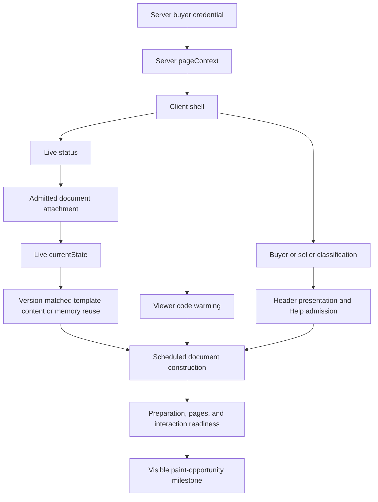

# Local data and Convex baseline

Recorded: 2026-11-25. Phase 01 of the [implementation plan](local-first-implementation-plan.md).

**Reading this record:** the original Phase 01 baseline below is preserved as historical evidence, including its then-current request paths and future decision rules. Later sections record the decisions and completed checks. All 29 implementation phases are now closed; use the [current architecture](local-first-architecture.md), [final verification](#phase-28-final-verification--2026-11-25) and [closeout](#phase-29-architecture-closeout--2026-11-25) for the implemented state. Runtime measurements remain unavailable.

Application baseline: Git commit `30d20d27ca4964b7f0a89972ebaf57038187faf9`. The tracked application worktree was clean when inspected. This phase adds documentation only and changes no app behavior.

## Evidence and decision

The available baseline is a source review of the current request paths and instrumentation. No captured browser trace, timing dataset, HAR, or Convex usage export was found in the repository. No Convex usage connector is available in this session. No live deployment logs were queried. Existing synthetic performance checks describe controlled guarantees; they are not a latency dataset and were not run for this phase.

**Runtime samples collected: 0.** All cold/warm p50 and p95 timings, response sizes, actual backend execution counts, and native IndexedDB durations are unavailable. The counts below describe work requested by code under stated conditions; they do not establish production execution cost or user-visible latency.

Use the plan's default removals when measurements are unavailable. Retain the optional contract Home disk first page only if Phase 13 establishes a median improvement of at least **100 ms in first useful contract cards on warm full reloads**, with no worsening of p95. This is a decision rule, not an observed result. Keep the buyer-link first page, saved-document snapshots, template authoring caches, and draft journal under their planned bounds and ownership rules.

## Home and edit request baseline

| Trigger | Current work established by source | Evidence limit |
| --- | --- | --- |
| Authenticated Home full load | The server starts `accounts.viewer`, `accounts.startupHome`, and `accounts.setupStartup` in parallel after obtaining the shared auth token. The startup contract page requests 24 rows. The client also observes the viewer. | Three separate server query calls do not imply three serial round trips. Their execution times, streaming arrival times, and overlap with client reads are unknown. |
| Home live results mount with empty search | Contract pager requests an initial 24 rows; buyer-link pager requests 10 unless link presence is known false. `buyerLinks.dashboardPresence` is a separate Home subscription. | Pager subscriptions can update, split, or catch up to remembered pages. A subscription registration is not an exact count of backend executions. |
| Home after first contract live page and two animation frames | Once per results component instance, `syncDirectory` launches both contract and buyer-link scans, each requesting 100 rows per cursor page until `isDone`. This includes the buyer-link scan when the visible buyer pager is skipped. | Navigation, a new sync, disposal, or unavailable scope can stop a scan. In-flight reads have already been requested. The two scans run concurrently; pages within each scan run sequentially. |
| Confirmed local save, rename, or delete callback | Invalidates both first pages, patches known directory rows, and starts both complete scans again, including on document routes without Home mounted. | Count per confirmed callback; do not assume one callback per keystroke, attempted save, or server mutation. Live subscription reevaluation is additional and unmeasured. |
| Admitted workspace, including a direct document route | Starts two first-page disk hydrations and two complete-directory disk hydrations. Directory reads load and validate all persisted rows. | This is local work, not a Convex call. It does not gate rendering directly. Native duration, allocation cost, and stored bytes are unknown. |

Sources: [server Home load](<../src/routes/(workspace)/contracts/+page.server.ts>), [live Home](../src/lib/components/workspace/Contracts.svelte), [Home frame](../src/lib/components/workspace/ContractsFrame.svelte), [workspace mount and edit callbacks](../src/lib/auth/WorkspaceScope.svelte), and [directory scan owner](../src/lib/auth/workspace-read-snapshots.svelte.ts).

For one successful, uninterrupted complete refresh, let `Pc` and `Pb` be the actual cursor-page counts for contracts and buyer links. It initiates **`Pc + Pb` direct browse calls**, with at least one call for each list, even if a list is empty. Each page asks for 100 items; native pagination and filtered buyer rows can make pages shorter. The exact page count requires returned cursors or a trace.

Illustrations assuming full pages, valid rows, and an `isDone` result on the final data page:

| Contract rows | Buyer-link rows | Background browse calls per complete refresh | Initial Home browse requests plus that refresh, when both visible pagers run |
| ---: | ---: | ---: | ---: |
| 24 | 10 | 2 | 4 |
| 1,000 | 250 | 13 | 15 |
| 10,000 | 1,000 | 110 | 112 |

These exclude presence, viewer/setup/HubSpot reads, immutable-content prefetch, later visible pages, retries, and reactive reevaluations. They are illustrations, not observed totals. A confirmed edit starts another refresh of the same shape using the resulting workspace contents.

[Contract browse](../src/convex/contractDirectory.ts) resolves connection and creator presentation in addition to reading directory rows. [Buyer browse](../src/convex/buyerLinks.ts) resolves each linked directory row and filters unavailable links. Eliminating complete scans therefore removes more work than merely transferring IDs. The current schema, SDK caching, and deployment must determine the actual execution savings.

## Available timing surfaces

[Startup instrumentation](../src/lib/auth/startup-perf.ts) and [document instrumentation](../src/lib/document/runtime/render-perf.ts) are enabled in development or when the existing `PUBLIC_DOCUMENT_PERF` setting equals `1`. They retain bounded numeric data in the current browser page; they are not persisted or sent to analytics.

| Target | Existing marks or buffers | Meaning and missing measurement |
| --- | --- | --- |
| Auth and Home admission | `window.__accountStartup`: `clerk-script-available`, `clerk-ready`, `backend-authenticated`, `account-ready`, `home-mounted`, `contracts-admitted` | Browser milestones use `performance.now()`. A full navigation also needs its navigation timing to include server/auth work before the client starts. `attemptId` identifies startup attempts, not every Home visit. |
| Home results module | `contracts-results-module-requested`, `contracts-results-module-ready`, `contracts-results-module-error` | Time around the lazy import. The lightweight fallback currently reads disk/memory directories or first pages; it does not consume `startupHome`. Phase 03 must make startup cards available there before the disk decision. |
| Contract directory disk hydration | `contracts-directory-read-start`, `contracts-directory-read-ready`, `contracts-directory-read-unavailable`, `contracts-directory-read-error` | Result marks carry a `duration` in milliseconds using `Date.now()`. There is no equivalent buyer-directory timing or directory-write timing. |
| Early Home cards | `contracts-local-cards-ready`, `contracts-first-live-page`, `dashboard-painted` | Local-ready is emitted by the lightweight fallback when nonempty contract rows exist, even before row reveal. First-live marks data availability once per results instance. Dashboard-painted is a two-frame opportunity after `hasPage`, can repeat, and can describe an empty page. None identifies which source supplied the first actually visible useful cards. |
| Home background work | `window.__contractHomeWarmingPerf`, `home-warming-start`, `home-warming-end` | Records visible-contract warming and supported long tasks during its lifetime. It does not isolate directory-scan cost, and unsupported long-task observation is not zero work. |
| Home search readiness | No dedicated Home search timing sample | The normal and fallback debounce are 200 ms. Local substring filtering can appear before a settled indexed live result. Record provisional appearance separately from complete current results; document search counters measure a different feature. |
| Saved contract opening | `window.__documentColdStart`: `contract-cache-hit`, `contract-cache-miss`, `contract-disk-cache-hit`, `contract-snapshot-fetch-start`, `contract-snapshot-cached`, `contract-data-ready`, `contract-navigation-to-document-ready` | Distinguishes several reuse and readiness paths. The navigation duration exists for instrumented client navigation, not every full reload. Metadata and immutable transfer duration are not separately marked. |
| Document display | `window.__documentLoadingPerf`: `first-pages-dom-ready`; cold-start `first-exact-display`, `interaction-ready`, `first-visible-paint-opportunity`; `window.__documentRenderPerf` | DOM, interaction, renderer, and paint-opportunity data. They do not prove physical paint. The renderer fields separate some composition and mount work but cannot assign unmarked Convex wait time. |
| Buyer full-page opening | `buyer-entry-status-start`, `buyer-contract-open`, `buyer-content-start`, `buyer-content-ready`, `buyer-viewer-code-start`, `buyer-viewer-code-ready`, `buyer-workspace-admitted`, `buyer-contract-visible` | Content-ready combines state and immutable-content acquisition. Visible duration starts at the document opening attempt, after server admission and possibly client status. It is not full navigation duration. No separate status-ready, state-ready, or template-read completion marks exist. |
| Copy link | No dedicated click-to-clipboard sample | Needs elapsed time through successful `navigator.clipboard.writeText`, split into existing-link and create-link cases. Busy text and network events alone do not measure clipboard completion. |

Startup arrays and most document arrays retain only 100 entries. Repeated marks can be trimmed; startup User Timing marks with the same name are cleared before replacement. Export the bounded arrays promptly and group related events by visit/opening chronology. Missing or trimmed marks must remain missing rather than be converted to zero durations.

Search debounce source: [workspace layout](<../src/routes/(workspace)/+layout.svelte>) and [Home frame](../src/lib/components/workspace/ContractsFrame.svelte).

## Saved documents, buyer openings, and Copy link

[Saved snapshot loader](../src/lib/contract/snapshot-cache.ts): a ready memory entry returns immediately. A complete disk entry can supply confirmed metadata and frozen content without redownloading the immutable version. A cold loader reads `contracts.state` and, after obtaining its version, reads `templates.frozenContent` if that version is not already available. The editor's current metadata subscription can overlap this work; current live authority still gates editing. Count immutable downloads separately from live state observations, and record prior Home warming so a prefetched opening is not misclassified as cold.

[Buyer opening](../src/lib/buyer/contract.svelte.ts): the server [layout](<../src/routes/(buyer)/+layout.server.ts>) reads `buyerLinks.pageContext`; the [shell](../src/lib/buyer/BuyerShell.svelte) observes `buyerLinks.status`; a current status admits `buyerLinks.currentState`, whose version enables `buyerLinks.templateContent`. Viewer code starts warming separately. A new page session has no persistent buyer-content cache. Reopening within the same shell can reuse its in-memory version content. This is a real dependency chain, but none of its individual network delays is measured here.

[Copy link controller](../src/lib/buyer/links.svelte.ts): on the existing-link branch, it reads `buyerLinks.latest` then copies the returned permanent URL. That branch returns before pending-save handling or `contracts.state`. When no link exists, it may settle a pending save, reads state, verifies readiness, then calls `buyerLinks.ensureLatest` before copying. Successful action results can be retained for retry. Phase 25 must preserve these distinct branches while reusing settled observations; adding a save or state read to the existing-link branch would introduce work the current path avoids.

## Comparison protocol for later measurement phases

Use the same application/deployment revision, device, browser, viewport, network conditions, document, and workspace for each comparison. Record whether this is a production build or development run. Keep small and large workspaces separate; record actual contract/link row counts when available. Do not pool these populations into one median.

| Scenario | Required starting condition | Record |
| --- | --- | --- |
| Cold Home full load | Fresh relevant app cache and no retained Home memory; authenticated session stated | Navigation to first visible useful contract cards, first useful buyer-link cards, current live page, and background browse work |
| Warm Home full reload | Same scope and populated caches within retention age; full page reload resets memory | Same milestones, plus observed first card source and whether startup arrived before disk |
| Home route revisit | Same runtime and scope, last browse page retained | Useful cards and current live replacement; keep separate from reloads |
| Settled contract edit | Home-mounted and direct-document cases recorded separately; one accepted edit at a time | Callback/acknowledgement to background scan completion, browse calls, and live list changes |
| Home search | Final input timestamp, settled term, same workspace; include a term outside the first page and a zero-result term | Input to provisional rows and input to matching complete live result; include debounce in total |
| Saved document | Cold version, disk restore after reload, and memory/prefetched revisit recorded separately | Navigation/click to visible document and interaction readiness; live metadata, immutable downloads/bytes, render work |
| Buyer document | First full open, repeated full open, and same-shell reopening recorded separately | Navigation to visible document; server page context, status, state, immutable content, and code/render spans wherever observable |
| Copy link | Existing permanent link and create path; pending-save state recorded | Click to successful clipboard completion, latest/state reads, save wait, and action wait |

For controlled runs, record each sample and report p50/p95 with sample count; use at least 30 successful samples per comparable condition for the optional disk decision. Record failed, timed-out, or canceled attempts separately instead of silently dropping them. Alternate the two comparison conditions to reduce order bias. If the p95 difference is unclear at that sample size, the disk cache has not cleared the decision rule. The 100 ms rule requires evidence that first useful cards came from the compared sources; substituting first-live or dashboard-painted does not establish it.

Collect Convex function-level execution counts, execution time, and available read/response bytes over an isolated visit/edit window where accessible. Keep SDK calls/subscriptions separate from observed server executions. Browser WebSocket traffic multiplexes queries, so HTTP request counts and Resource Timing alone cannot establish Convex query counts. A deployment-wide usage total cannot be assigned to one visit without a controlled window or correlation.

Existing buffers can be exported manually from DevTools on an instrumented page without adding app code:

```js
JSON.stringify({
  timeOrigin: performance.timeOrigin,
  navigation: performance.getEntriesByType('navigation').map((entry) => ({
    type: entry.type,
    startTime: entry.startTime,
    responseStart: entry.responseStart,
    responseEnd: entry.responseEnd,
    domContentLoadedEventEnd: entry.domContentLoadedEventEnd,
    loadEventEnd: entry.loadEventEnd
  })),
  account: window.__accountStartup ?? [],
  document: window.__documentColdStart ?? [],
  loading: window.__documentLoadingPerf ?? [],
  render: window.__documentRenderPerf ?? [],
  homeWarming: window.__contractHomeWarmingPerf ?? []
}, null, 2);
```

This exports numeric timing and named milestones; it does not supply the missing source attribution, query counts, search timing, clipboard duration, or server spans. User-led browser observation or later targeted instrumentation can fill those gaps in the designated measurement phases. This phase performed neither browser checks nor automated tests.

## Phase 01 outcome and later dependencies

- Baseline application revision, current request shape, usable marks, missing measurements, and the disk-cache decision rule are recorded. Phase 01 is complete under its available-evidence provision.
- Phase 03 must expose server startup cards in the lightweight fallback before Phase 13 compares disk versus startup. Phases 06–07 must preserve the distinction between provisional rows and complete search results.
- Phase 08 can remove code-established complete scans; any performance claim must distinguish avoided requested work from measured backend executions and paint latency.
- Phases 13, 23, and 26 still own their measurement and decision work. No optional query merge or disk retention is justified by this baseline alone.
- Phase 25 must preserve the existing-link fast branch. Phase 28 must compare equivalent cache states and report missing native/runtime evidence explicitly. Automated verification remains in Phases 17 and 28.

## Phase 13 decision update — 2026-11-25

**Remove the contract first-page disk projection in Phase 14.** Rechecking repository evidence and available tools found no comparable warm-reload measurements. Samples remain **0 per condition**; median improvement, p95, first-visible-card source, actual backend execution counts, response sizes, and native IndexedDB durations remain unmeasured. The cache has not cleared the stated retention threshold, so this applies the plan's default removal. It does not prove that disk is slower or that removing it improves paint.

Both Home render paths now expose eligible scoped startup cards, keep exact-query live pages in route memory, and let current live results replace provisional rows. The possible tradeoff is waiting for live contract data on a reload/entry with no eligible startup or memory page. Keep the buyer-link first-page seed, which has no startup equivalent, and keep the separate saved-document/template caches. Phase 14 owns application removal and scoped deletion of obsolete contract projection records; it must preserve startup retirement separately from disk confirmation. Phases 17 and 28 own automated checks and acceptance. The original Phase 01 revision, request counts, and instrumentation descriptions above remain historical baseline evidence.

## Phase 17 automated checkpoint — 2026-11-25

The refactored application passes 38 existing performance tests and 195 existing lifecycle tests (16 SSR, 21 client, 158 component), including all 16 Home checks. Convex TypeScript and application/tooling semantic checks pass. Five existing fixture files were maintained, and a Home source type issue was fixed without changing emitted runtime. No new tests or browser checks were added.

These results verify existing correctness and work-budget assertions; test-run duration is not an application performance sample. The original application revision and measurements above remain the historical baseline. Runtime samples remain **0 per condition**; p50/p95, first-useful-content source, actual Convex execution counts/response bytes, and native migration/purge timing are still missing. Direct Team behavior, native blocked/late-open/upgrade, cross-tab deletion, and early-live/confirmed-callback ordering were not established by these suites. Keep the remaining measurement/acceptance phases and conditional-query defaults unchanged.

## Phase 23 buyer cold-open decision — 2026-11-25

**Keep the current buyer read split and memory-only immutable-content reuse.** Source review establishes a serial status-to-state dependency, but no runtime evidence establishes how much changing it would improve visible document time. Phase 24 should close without a query merge under the plan's no-evidence default unless comparable measurements become available. This does not establish that the split is faster. No application code, instrumentation, tests, or browser behavior changed in Phase 23.

The review follows the current uncommitted implementation through Phase 22; it does not replace the original Phase 01 application baseline above. Repository searches found no captured HAR, timing dataset, or trace, and available tools expose no Convex usage/latency connector. No deployed logs or live buyer links were queried. **Runtime samples remain 0 for every condition.** No p50/p95, actual backend execution counts, response sizes, or physical paint measurements are available.

### Actual dependencies and overlapping work

| Stage | Starts after / supplies | Effect on useful display |
| --- | --- | --- |
| Server buyer credential | [Buyer layout](<../src/routes/(buyer)/+layout.server.ts>) awaits [credential classification](../src/lib/server/buyer-token.ts) before calling Convex. An anonymous request can classify without an account fetch; an account request can require Clerk verification/token acquisition. | This is before client construction and must be recorded separately from `pageContext`. Unknown credentials produce account-error presentation. Deadline settings are limits, not observed durations. |
| Server `pageContext` | Reads current link availability and verified buyer/seller audience for the first-response title. [Route read](../src/lib/server/route-title.ts) owns its request deadline/cancellation. | The layout awaits this read. Only a current result constructs [AnonymousProvider and BuyerShell](<../src/routes/(buyer)/+layout.svelte>). Returned route data contains presentation, not document state or a reusable live client admission. |
| Client `status` | [BuyerShell](../src/lib/buyer/BuyerShell.svelte) subscribes on the anonymous transport. A non-rejected current result admits access and constructs the document page. | This genuinely gates cold document attachment and therefore `currentState`. It also supplies company/buyer heading presentation and remains live for access withdrawal. |
| Client `currentState` | [BuyerContract](../src/lib/buyer/contract.svelte.ts) requires allowed access and an attached target before subscribing. The read supplies version, title, revisions, concessions, display identity, and applied overlays. | It stays live. With concessions, the backend resolves active overlay items in addition to link access; this work is absent from the small status result. |
| Immutable `templateContent` | The first state result supplies `templateVersionId`. Missing versions use `queryOnce` with token and exact version, which releases the subscription after its first result/error/cancellation. | The backend rechecks live link/version access, then reads blocks and raw buyer explanations in parallel. Same-shell template/in-flight maps avoid repeating this work for an already available version. Full reload resets them. |
| Viewer code | `warmCode()` starts on shell mount, independently of status, seller classification, and immutable bytes. The actual opening reuses the same import promise. | Content and code join before scheduled subtree admission. Adding their elapsed spans together would overcount overlapping work. Code readiness alone admits no document. |
| Seller header / Help | [BuyerSeller](../src/lib/buyer/seller.svelte.ts) classifies alongside public-link reads. A browser without account evidence can become a buyer directly; account evidence starts the separate authenticated transport and `sellerContext`. | Header readiness/presentation and Help policy gate document host construction. A late header receives a paint opportunity; automatic Help receives one before document construction. The separately observed avatar is not a body gate. |
| Document presentation | [BuyerContractPage](../src/lib/buyer/BuyerContractPage.svelte) joins allowed access, header/Help readiness, code, and content. The document then prepares, paginates, mounts pages, and reaches interaction readiness. | `buyer-contract-visible` follows successful presentation and a requestAnimationFrame/timer opportunity with opening/generation/target guards. It is neither navigation-to-first-page timing nor proof of physical paint. |



On a cold successful opening without retries or retained results, source code registers one server page-context read and three client document-path reads: status, state, and template. These are **four logical read registrations**, not four measured backend executions or the total requests for a visit. Account classification/context/avatar, name refresh, activity, discussions, retries, and live reevaluations can add work. The shell's `/api/buyer/name` refresh is fire-and-forget; it does not directly gate attachment, although resulting data updates can arrive while opening.

All four buyer queries independently call `resolveView`, which checks the token/link, company availability, and contract cleanup. That repeated gate work is a candidate for consolidation, not evidence of its execution cost. A status/state merge removes a logical dependency but makes the early result wait for overlay projection and couples header/access delivery to the state payload. Keep immutable bytes separate from any proposed live admission result. Do not use the first-response title/audience or retained bytes to bypass current client access.

On same-shell reattachment, retained content can become mount-ready while the renewed state subscription runs; it does not always wait for another first state/template result. Continuing live status still gates access. Loss of access or destruction clears content/template reuse; release stops state observation and advances the generation. Preserve these lifetimes and retry/deadline fences when evaluating a future query change. A repeated full open must remain a separate sample population because it creates a new shell and loses memory reuse.

### What would justify revisiting Phase 24

The existing `buyer-entry-status-start` mark runs on mount, not at a verified network dispatch. `buyer-contract-open` begins after server/current-status admission and document attachment. `buyer-content-ready` combines state and template acquisition; there are no separate server, status-ready, state-ready, or template completion/cache-source spans. The existing header test controls classification and proves ordering/independent avatar readiness; it supplies no real latency samples and was not rerun here.

For a later comparison, record request/navigation start, server credential and page-context spans, status dispatch/result, attachment, state dispatch/result, template dispatch/result or memory reuse, code ready, header/Help ready, first page DOM readiness, and interaction/visible opportunity separately. Use a common browser time origin or explicit server-duration correlation; do not subtract unrelated server/browser clocks. Record failures, timeouts, cancellation, revocation, and state/version changes separately. Numeric milestones need no tokens or document content.

Separate anonymous buyers, account-session viewers, first full opens, repeated full opens, and same-shell reopening, with document size/concession count, build, device, and network held comparable. Use the existing baseline comparison protocol for samples and p50/p95. Support a merge only if it improves navigation-to-useful-document timing without delaying useful header presentation or worsening p95; verify the current-access, revocation, mutable-state, exact-version immutable-content, and retry behavior too. A reduced registration count or a shorter content-only span is insufficient. No buyer disk persistence is justified by this phase. Required automated/runtime acceptance remains Phase 28.

## Phase 24 buyer admission outcome — 2026-11-25

**Closed with no application change.** Phase 23's available-evidence default applies: no comparable timing samples have arrived, repository searches found no captured runtime dataset, and available tools still expose no Convex usage/latency connector. The existing buyer shell/contract/page, server layout, and Convex buyer query files have no worktree changes. Runtime samples remain **0**; no latency, response-size, execution-count, or physical-paint comparison was performed. This is not a measured finding that the split wins.

Retain the small live status, live mutable document state, exact-version first-result immutable-content read, and shell-owned memory/in-flight reuse. Early header/Help presentation, parallel code warming, current access/revocation, live state changes, and existing cancellation/generation/deadline fences remain. No buyer persistence, combined query, server-presentation admission shortcut, or instrumentation was added.

The preceding Phase 23 comparison protocol defines what would justify a later query change. That possibility is a conditional future optimization; Phase 24 has no unfinished implementation. Phase 25 separately addresses settled seller observations during Copy link. Automated verification and user-led buyer acceptance remain in Phase 28. Phase 24 changes only the plan, assessment, and this decision record; no tests, build, browser checks, or live-service profiling ran.

## Phase 25 seller Copy link reuse — 2026-11-25

Phase 25 implements source-level preflight reuse while retaining the original Phase 01 baseline above. The [controller](../src/lib/buyer/links.svelte.ts) accepts an optional settled latest-result accessor from the [saved footer](../src/lib/buyer/BuyerLinkBar.svelte). Other callers retain explicit latest reads. The [saved-view subscription](../src/lib/components/workspace/SavedContract.svelte) now supplies its transport generation and direct account admission gates. The [read owner](../src/lib/auth/read-query.svelte.ts) exposes strict `currentData` separately from retained `data`: argument key, generation, retry revision, settled attempt, error, and rejection determine reuse. Accepted null means no link; undefined means read explicitly.

| Click condition | Original explicit preflight reads | Implemented explicit preflight reads | Preserved behavior |
| --- | --- | --- | --- |
| Existing link and settled saved-view latest result | Latest only | None | Copy directly; no editor reservation, draft lookup, save, state/readiness check, or create action |
| No link; latest and editor state settled | Latest then state | None | Check pending intent and readiness; dispatch `ensureLatest` with confirmed revision |
| No link; latest settled but editor state unavailable | Latest then state | State | Explicit state preflight and all create guards |
| Latest unavailable; editor state settled, and explicit latest returns null | Latest then state | Latest | Use confirmed editor state only after pending saves settle |
| Both observations unavailable, and explicit latest returns null | Latest then state | Latest then state | Existing fallback/save/readiness/revision path |
| Standalone caller finds an existing link | Latest only | Latest only | Direct copy before reserving an editor |
| Retained uncertain action or confirmed action result | Reuse original operation/result | Reuse original operation/result | Do not reprepare with newly observed state; confirmed results still require a click to copy |

These counts concern explicit controller SDK reads requested on an otherwise successful click, not subscription activity, SDK cache hits, actual backend executions, or elapsed network time. Pending saves may add mutations and other work. A settled null read is only preflight: concurrent publication is resolved by the existing backend capture, which returns an already active link before creation-only policy/revision checks. Membership/access, receipts, work policy, state revision, readiness, and transaction authority remain on the server.

The [existing link reservation](../src/lib/contract/editors.svelte.ts) exposes current state only when local intent has settled and the editor is live-validated. It uses persistence-confirmed concessions/revision and current work policy, allowing a save acknowledgment ahead of live metadata without using draft selections or a readable snapshot. Missing state still requires an explicit read. Publication invalidation remains before clipboard work, including late completion; existing-link copies do not invalidate retained Home rows.

No disk/localStorage/sessionStorage cache, new subscription, query shape, background refresh, or instrumentation was added. Existing display retention and idempotent retry behavior remain. Source formatting and TypeScript syntax/Svelte compilation pass with zero warnings; affected fixtures were maintained without new tests or weakened assertions. Automated performance/lifecycle/semantic/build verification and user-led clipboard/transport/reuse acceptance remain Phase 28. The new reuse branches have not been exercised at runtime. Runtime samples remain **0**; click-to-clipboard p50/p95, actual response sizes/executions, and clipboard activation behavior are unverified. No measured speedup is claimed.

## Phase 26 Home startup decision — 2026-11-25

**Retain the independent startup reads under the available-evidence default.** The current full-load path has no viewer → Home → setup query sequence. There is repeated account/projection work, but no runtime evidence that it delays useful Home display. Runtime samples remain **0**. Repository searches found no captured trace/timing/usage dataset, and the available tools expose no Convex timing or usage connector. No live service, browser, application instrumentation, or automated suite was used. This section profiles the current implementation; the Phase 01 tables above preserve the original baseline.

### What actually gates useful Home display

The [server page load](<../src/routes/(workspace)/contracts/+page.server.ts>) obtains one shared Clerk token promise and immediately returns three separate result promises. After the token arrives, `accounts.viewer`, `accounts.startupHome`, and `accounts.setupStartup` can execute concurrently, each using its own HTTP client, cancellation signal, and 5-second budget that includes token wait. Each failure independently becomes null. The load does not await the results or `parent()`. Client data-request navigations skip these assists. Source-level streaming independence does not establish when a deployed adapter/network delivers the chunks; buffering remains unmeasured.

| Result or prerequisite | Consumer and dependency | Effect on useful display |
| --- | --- | --- |
| Clerk identity, authenticated account code, backend auth | AccountSession warms transport/code independently; SessionScope mounts for the matching session and authenticates the Convex connection | Server data cannot bypass browser authentication or account admission |
| Server viewer or current client viewer | AccountGate prefers an available live result; an eligible initialized startup viewer may assist until live data/error arrives | First account admission can use the earlier eligible result after backend auth; startup null/uninitialized results cannot provision an account |
| Shared account-content code and membership | RequireAccount waits for admission, the published account/client, and AccountContentScope; WorkspaceBoundary requires current member/company | Private Home mounting can also wait for code, membership, or recovery; this is separate from server query latency |
| Contract rows | The fallback and full results select current live, exact-query memory, or eligible scoped startup; the live pager requests 24 rows | Startup cards can appear without the results module. When startup/memory is absent, cards wait for live data and the module that owns its pager |
| First-visit reveal | ContractsFrame gives headings two animation frames before showing rows; the workspace search owner's visited flag skips later staging | Row availability and first useful visible cards are different milestones |
| Setup progress | WorkspaceShell shares setupHints with the prompt/support; matching setupStartup assists until hints data arrives | Setup does not gate account admission, headings, or contract cards; it has its own useful-display race |

[AccountSession](../src/lib/auth/AccountSession.svelte) preloads account/content/destination/results code independently of admission, so results-module download is not inherently a serial step after the viewer query. [StartupDataProvider](../src/lib/auth/StartupDataProvider.svelte) consumes the three promises independently and fences assistance by Clerk session/user, initial transport generation, and closing state. Home additionally checks exact profile/membership/company scope, default search/cursor/page size, and startup eligibility. Current live rows, including empty results, supersede startup; invalidation or recovery cannot revive old startup authority.

An optional hint-only `accounts.workspaceRole` HTTP read can run when neither an account result nor matching session hints is available. It shares neither the server assist token promise nor the live connection, and its 5-second budget includes token/code acquisition. It helps the provisional skeleton only, never private admission. Include it when measuring total startup work rather than assuming every full visit performs exactly three reads.

### Repeated work and the tradeoff

[Backend accounts](../src/convex/accounts.ts) and [membership authorization](../src/convex/auth.ts) show these source overlaps:

| Overlap | Repeated work | Why removing it needs evidence |
| --- | --- | --- |
| Three server assists | Identity/deleted-user/profile/membership/company reads; viewer and membership paths also inspect deletion state | One bundled result could save repeated work but make the first account/setup result wait for unrelated work and share its failure |
| Server/client viewer | Same viewer projection; avatar URLs, deletion, instructions, and conditional pre-template setup booking follow the core account reads | Server assistance can arrive earlier; the subscription supplies current revalidation and access withdrawal |
| startupHome / live contracts.browse | Same bounded directory reader, including installation policy and per-page deduplicated creator/name/avatar resolution | Startup may win before the client pager mounts; live results provide current data, search, and pagination |
| setupStartup / live setupHints | Same authorized checklist with early exits; later steps may inspect contract/link, integration, or invitation facts | Startup can show setup independently of cards; live hints reconcile changes and authoritative completion is still a server mutation |

Viewer waits for its own presentation/deletion/instruction/conditional-booking branches. Home waits for authorization, installation, the bounded directory page, and creator presentation. Setup walks only the checklist steps needed by the current membership. These are genuine dependencies inside each result, not measured causes of slow Home. Collapsing them into a single live subscription would also widen the reactive dependency/result surface; a server-only bundle would still couple initial delivery unless designed otherwise.

The older registered `accounts.startup` endpoint does await viewer and then directory, but source searches found no application or test caller. It is not the full Home loader and should not be used as evidence of a current waterfall or adopted as the replacement just because it already exists. General unused-API cleanup is separate from this conditional performance change.

These comparisons describe function/helper calls requested by source, not observed backend executions, cached query hits, request bytes, or latency. The server issues three independent assists when its full-load conditions hold; subsequent viewer/setup/presence/contract/buyer/integration activity and optional hints make total visit work conditional. HTTP counts alone cannot describe the live connection's multiplexed execution work.

### Evidence needed before changing Phase 27

Collect comparable production full-load cold and warm samples separately from same-runtime Home revisits, under the [existing comparison protocol](#comparison-protocol-for-later-measurement-phases). Record navigation/initial HTML, server token and each assist execution/stream arrival where available, Clerk/backend auth, account/content/results code, first admitted heading, first visible nonempty contract/buyer cards with their selected source, setup prompt, and matching live replacement. Keep setup-complete, pre-template, and larger-workspace populations distinct; record failures/timeouts/cancellations separately. Compare useful-display p50/p95, request/read/response bytes, and isolated backend execution cost, with sample counts. Do not optimize one path by silently delaying another useful result or current revalidation.

Existing `window.__accountStartup` marks cover Clerk/backend/account/Home admission, results-module loading, fallback nonempty rows, first live result, and a two-frame dashboard paint opportunity. They have no server token/query/stream spans, no source attribution, no dedicated first-heading/setup timing, and no physical first-card paint guarantee. `account-ready` can come from startup assistance; `contracts-local-cards-ready` can precede reveal; `dashboard-painted` can repeat or describe an empty page. Bounded buffers and attempt IDs cannot replace navigation correlation. The Phase 01 removed-directory marks must not be mistaken for current instrumentation.

**Phase 27 decision:** absent comparative evidence, keep the three independent assists, the client live reads, and existing storage split. Do not merge for request count, remove assistance, postpone current reads, or add durable viewer/setup/contract projections. This does not prove the current shape is faster; it avoids an unsupported change to independent availability. Preserve existing streaming, scope, initialization, heading/setup/card staging, delayed-startup fallback, and live-currentness assertions for Phase 28. They describe controlled behavior, not deployed streaming or production latency; none was rerun here.
## Phase 27 Home startup outcome — 2026-11-25

**Closed without application changes under Phase 26's evidence gate.** A fresh repository capture search and available-tool inventory found no new timing/usage dataset or Convex telemetry connector. Runtime samples remain **0**. No browser experiment, service call, instrumentation, or automated suite ran. The original Phase 01 baseline and Phase 26 source profile remain intact.

Keep the independent full-load viewer, Home, and setup assists, their shared token acquisition and separate failure/deadline handling, and the current client live reads. Preserve scoped first-admission assistance and separate setup/card availability; add no durable viewer/setup/contract projection. Source-established repeated work alone does not justify a merge, removed assistance, or delayed revalidation. This is the planned no-evidence decision, not proof that the existing shape is faster or optimal.

Phase 28 is the next dedicated verification checkpoint. Run the required existing suites, semantic checks, production build, and bundle checks there. Keep user-led deployed streaming, first-visible source, full-load versus navigation, and timing acceptance distinct from automated guarantees. Actual useful-display p50/p95, backend execution cost, response sizes, and deployed stream arrival remain unverified; use the Phase 26 comparison protocol if measurements become available. This phase changed only the implementation plan, assessment, and baseline record.

## Phase 28 final verification — 2026-11-25

**Automated checkpoint complete.** Node 24.20.0 is active. The corrected full `npm run verify` command exits **0**, and the separate `npx tsc --noEmit -p src/convex/tsconfig.json` check exits **0**.

| Final check | Result |
| --- | --- |
| SSR | 16 tests / 3 files pass |
| Backend | 105 / 16 pass |
| Client | 21 / 4 pass |
| Components | 158 / 23 pass |
| Required performance suite | 38 / 7 pass |
| Svelte/application semantics | 0 errors, 0 warnings |
| Tooling TypeScript and separate Convex TypeScript | Pass |
| Production build and Vercel adapter output | Pass; no deployment performed |
| Emitted loading boundaries | Public frame, persistent Contracts, creation, saved/help admission and buyer contract entry pass; demanded document modules remain emitted |

This is 300 existing tests plus 38 performance executions of existing cases, not 338 distinct new tests. The first pipeline passed its suites, then stopped at semantic checking because two existing fixtures lacked required fields from Phases 18 and 25. Creation now supplies its existing session userId to cache ownership; loading recovery supplies currentState: undefined, preserving its explicit-fallback semantics. Their 28 targeted tests passed, then the complete command passed against the corrected worktree. Assertions and production code did not change in this phase. These final results are distinct from Phase 17; no new tests or browser automation were added.

Existing performance assertions check no-op/replayed saves and stale competing revision rejection, small saves without frozen-source reads/compilation, foreground scheduling and queued cancellation, shared availability reads, and snapshot reopening/confirmed updates without extra immutable downloads or writes. SSR checks independent startup settlement and bounded failures; component checks cover staged Home/search/fallback display, buyer header/access/resource behavior, draft recovery/conflict/immutable retries, existing-link explicit fallback, guarded creation and footer stability. These passing assertions establish their controlled scenarios; they do not establish the new physical cleanup or strict settled-link accessor branches.

### Acceptance limits

| Area | Existing automated evidence retained | User-led or otherwise unverified acceptance |
| --- | --- | --- |
| Disposable disk caches | Actual fake-IndexedDB commits/reopening and immutable-write/download counts with real Node Web Locks; emitted dependency boundaries. | Real native schema-6 removal/preservation, two-database retention, cross-reload inventory, multi-tab shutdown/deletion races, blocked/late native requests, unavailable registry/locks, failed marker writes, retry and matching-success reclamation. |
| Presentation hints and draft journals | Existing save, discard, initialization, auth/transport recovery, conflict and immutable operation/revision checks. | Physical exit/identity/membership cleanup, initially signed-out reload, fresh same-user owners, stale callbacks and late old-user exit, newer-session protection, per-key failures and retry; hints lack cross-tab atomicity and drafts remain tab-local. |
| Seller Copy link | Existing explicit latest fallback, no editor/template work for existing links, pending/recovered save guards, expected revisions, uncertain-operation retry and stable footer. | Strict settled-link accessor reuse and its pending/error/retry/generation exclusions, confirmed state ahead of live metadata, clipboard activation/failure behavior and actual click latency. Passing fallback tests cannot establish these new reuse branches. |
| Buyer opening | Existing header-before-body, avatar independence, access withdrawal, Help/preview, resource/retry and immutable reuse behavior. | Anonymous versus account-session full opens, cold/repeated versus same-shell reuse, version/content/code failures and real access changes. No separate server/query timing or navigation-to-first-page measurement exists. |
| Home and Team | Existing independent startup settlement/timeouts, scoped assistance, live-only initialization, Home staging/fallback/search/currentness and bounded request sizes. | Deployed stream buffering, first useful card source/physical paint, full loads versus client navigation and identity recovery, Team pending/empty/error/50-row paging/action permissions, actual cold/warm/search timing. |

The detailed Phase 28 scenarios remain in the [implementation plan](local-first-implementation-plan.md#28--final-automated-and-acceptance-verification). No user-led acceptance results or runtime captures have been supplied. The Phase 01 measurement baseline still has **0 runtime samples**: p50/p95, actual Convex execution counts, response sizes, post-paint work and copy latency have no before/after comparison. Avoided scans and fewer explicit SDK reads are source-established changes, not measured speedups. The automated checkpoint is closed; browser/native/timing gaps remain explicit in the final architecture record and are not certified as passed.

## Phase 29 architecture closeout — 2026-11-25

The core 29-phase implementation plan is closed. The architecture is now a current reference for the local/Convex split, Home source/currentness rules, bounded storage, identity/exit cleanup and remaining query dependencies. The data model, account-route, lifecycle and performance references agree with the implemented behavior. Historical phase notes and this original measurement baseline are preserved. No application code, fixtures, tests, service calls or browser checks changed/ran in Phase 29; the passing Phase 28 checkpoint remains the automated evidence.

The final split retains buyer-link first-page storage, immutable saved-document/template caches, tab-local contract intent and presentation hints. Browser complete directories, automatic full scans, contract/Team disk projections and opening history are removed. Retained IndexedDB payload budgets total approximately 52.125 MiB plus metadata/native overhead; pending historical deletion and undiscovered legacy stores can exceed that footprint. Source-established avoided scans and explicit reads have no measured p50/p95, Convex execution or response-size comparison.

The [acceptance limits](#acceptance-limits) and detailed Phase 28 scenarios remain unverified and user-led. Closing documentation does not certify physical cleanup, strict observation reuse, clipboard activation, Team browser behavior or achieved performance. Additional buyer disk retention, authoring draft backup and discussion optimism are separate evidence/product decisions, rather than unfinished core implementation phases.
