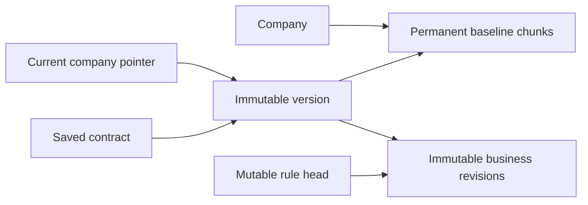

# Template storage

Current architecture entry point: [backend model](backend-redesign/architecture.md). Current local implementation: [Phases 9C](backend-redesign/phase-09c-publication-history.md) and [9D](backend-redesign/phase-09d-authoring-performance.md), reviewed in [9E acceptance](backend-redesign/phase-09e-authoring-acceptance.md). Phase 9 is complete locally. The schema and consumers have changed during the pre-customer cleanup; deployment remains a separate Phase 18 gate.

Each company owns one permanent baseline stored in ordered chunks. Mutable playbook heads own current rules and authoring retry state. Immutable revisions hold business content and the original rule identity. An immutable version contains ordered rule/revision references. A saved contract captures that version and continues to use its exact historical content after later authoring or live rule deletion.

`playbookItemRevisions` stores `companyId,itemId,itemCreatedAt,revision,body`. Its `body` contains only the canonical rule business fields. The captured revision number describes that historical content. Mutable `playbookItems` retain operation ID/caller and the published revision head. History has no replay metadata or duplicated identity inside the body.

`templateVersions` stores company/baseline IDs, publication time, counts, historical JSON/read-byte totals and `items:[{itemId,revisionId}]`. `currentTemplate` stores only `companyId,versionId`. The old per-rule manifest table and import/maintenance pointer state are removed.

## Publication and reads

Save and Delete publish synchronously in the same native Convex transaction as the live-head, immutable revision and receipt changes. Existing-rule saves have four primary document writes: head, revision, version and pointer. Creation allocates a head and its durable receipt; deletion retains immutable history. Replay/stale results keep their existing precedence. Explicit same-value rule Save still publishes.

Instruction-only saves validate local content and compare complete ordered trigger/concession structure. Exact equality carries the prior canonical audit forward: read the current pointer/version, permanent baseline metadata and edited head; replace one revision reference using exact historical/native byte deltas. They read no source chunks or unrelated rule bodies and retain the four-write atomic publication. Creation, deletion and structural saves read and audit the complete candidate source/playbook.

`savedContracts.state` returns fresh mutable metadata and the captured version ID. `templates.current` returns the current version ID; `templates.version` authenticates membership and resolves historical content. The historical result remains `{blockCount,itemCount,blocks,items}` with original item IDs/creation times/company/captured revision and business fields.

A reader validates the version and its ordered unique references once, then uses one item-ID map and transaction-local resolution cache. Selected reads fetch only selected revision bodies and check concession membership. Full reads resolve all revisions in reference order, in batches of 64, and read the shared baseline. A deleted live head does not affect historical access. All resolved revisions must match the version's company/item identity.

## Baseline integrity encoding

[Phase 17B](backend-redesign/phase-17b-baseline-encoding.md) derives the permanent source fingerprint and `blocksJsonBytes` from one canonical UTF-8 JSON encoding. Field ordering is canonical; array/source order is preserved. DOCX preparation and atomic operator bootstrap set both values together; chunk writing owns native chunk count/read-byte accounting. Readers retain ownership, sequence, completeness, count, read-byte and fingerprint checks. Stored values and chunk layout are unchanged, with no additional schema/cache/reset consequence. JSON byte length remains separate from native document/transaction admission. Existing and independent seed checks pass; native boundary/OCC/remote operator acceptance stays in 17D1/17D2/18.

## Baseline indexing

[C4A](backend-redesign/cleanup-c4a-source-index.md) completes the existing in-memory `SourceIndex`: source units/coordinates/containers/gaps, ordered blocks, block ordinals, numbering-item lookup and baseline addresses. One `CompiledContract` validates and owns the accepted baseline; `DocumentDomain` retains it until baseline content changes and shares its index with rendering/prewarming. Reference validation and range checks reuse those lookups. Composition derives separate active numbering and merge aliases only when paragraph structure changes, reusing indexed baseline addresses otherwise. [C4B](backend-redesign/cleanup-c4b-canonical-references.md) stores baseline-valid reference patterns and stable targets; editor display and effective export use composed numbering and merge aliases. No index data is persisted, no cache/schema format changes, and selection/output behavior remains unchanged.

## Browser persistence

An open editing session establishes fresh contract metadata and current access before admitting cached content. Speculative warming can reuse disposable cached metadata; it does not authorize opening or confirm edits. Shared version flights and object identity serve preview, creation handoff, opening and warming. Cancellation of one consumer preserves other consumers' shared read.

Memory/disk caches retain their 24-contract/24-version and combined 32 MiB bounds, optional-storage fallback, bounded deadlines, malformed repair and metadata-only updates. Confirmed IndexedDB format **6** retires obsolete snapshot/metadata stores. The separate tab-scoped sessionStorage intent journal is preserved; a confirmed-cache upgrade never clears pending edits. [11B](backend-redesign/phase-11b-cache-recovery.md) replaces private Convex validator introspection with explicit bounded persisted checks and shares saved-state validation with draft recovery. Confirmed metadata updates include complete reviews while retaining immutable identity and metadata-only disk writes. Formats and journal behavior remain unchanged; desktop Chrome/Edge and Safari are primary.

## Capacity and lifecycle

Existing bounds remain: 4,000 rules, 4,096 baseline blocks, 500,000 business JSON bytes per rule, 8,000,000 bytes of historical JSON and 1,024 selected concessions. Native document/array/query/read/write limits apply independently. Publication measures complete version/revision/source wrappers, checks remaining transaction capacity and preserves metadata/read headroom. Any rejection rolls back the complete publication. 9D documents exact representation/work/array/nesting calculations and local delta checks. [17D1](backend-redesign/phase-17d1-native-admission.md) accounts complete native wrappers and logical/native intersections and aligns snapshot entry admission with the 1 MiB document bound. The 128 KiB packing target is not a per-entry limit. Native metrics, assigned IDs, extreme boundaries and arbitrary parent/access metadata remain Phase 18 acceptance gaps; count/UTF-16 maxima and retained margins are not universal native-size guarantees.

Prepared DOCX conversion is separate from permanent publication. One atomic publication establishes company baseline ownership and the initial version/pointer. Originals and preparation expiry retain their existing lifecycle. Operator bootstrap uses the same canonical writers and refuses changed/incomplete state; `operator.readSeed` provides the scoped business projection for independent reconciliation. No staging or maintenance pointer is needed.

Live rule/contract deletion retains referenced immutable history. Company deletion drains source chunks, rules, receipts, versions, revisions and retained originals through its bounded worker. [16A](backend-redesign/phase-16a-deletion-recovery.md) completes durable bounded child cleanup and its complete table/file/job matrix locally; [16B](backend-redesign/phase-16b-identity-orphan-recovery.md) completes all-kind orphan recovery. Native failure/OCC/storage/frontier acceptance remains Phase 18.

[17D2](backend-redesign/phase-17d2-cross-workflow.md) implements private selected-rule Word capture with the complete baseline/manifest and unchanged access/revision/version/lifecycle/approval finalization. Historical body reads fall from 56 to K in canonical scenarios; all 29 Word document/styles XML pairs remain exact. Approved joined newline semantics are independent of unused highlights. Public snapshots and cache formats are unchanged. Native/browser/Word visual and file-retirement acceptance remain Phase 18.

## Verification and rollout

Phases 9C–9D passed the existing 20 lifecycle tests, 24 performance tests, frontend/backend types, production build and 58 seed output states with zero independent reconciliation mismatches. Existing assertions preserve atomic/replayed publication, stale handling, deletion history, selected-only save work, content-free creation, cache sharing and partial-publication rollback.

9E reviews the unchanged final implementation and those results, without test reruns or further runtime changes. Its acceptance matrix records the ordinary range/gap/reference paths, historical isolation, counted work and later verification owners. The user confirms the seed is broadly representative of customer baselines.

No new tests, browser automation or deployment occurred. A real cache upgrade with pending edits, deployed resource boundaries, remote bootstrap/read-back, arbitrary authoring interactions and Word visual output remain unverified. Earlier deployment/probe reports described older representations and do not certify this schema.

The user confirmed there are no external Convex readers/writers. Old deployment data is intentionally incompatible; use the [current target-specific Phase 18 procedure](backend-redesign/phase-18-activation.md). Do not run Convex dev/codegen or an old reset recipe to bypass that gate. Original archives and independent reconciliation inputs remain intact.
